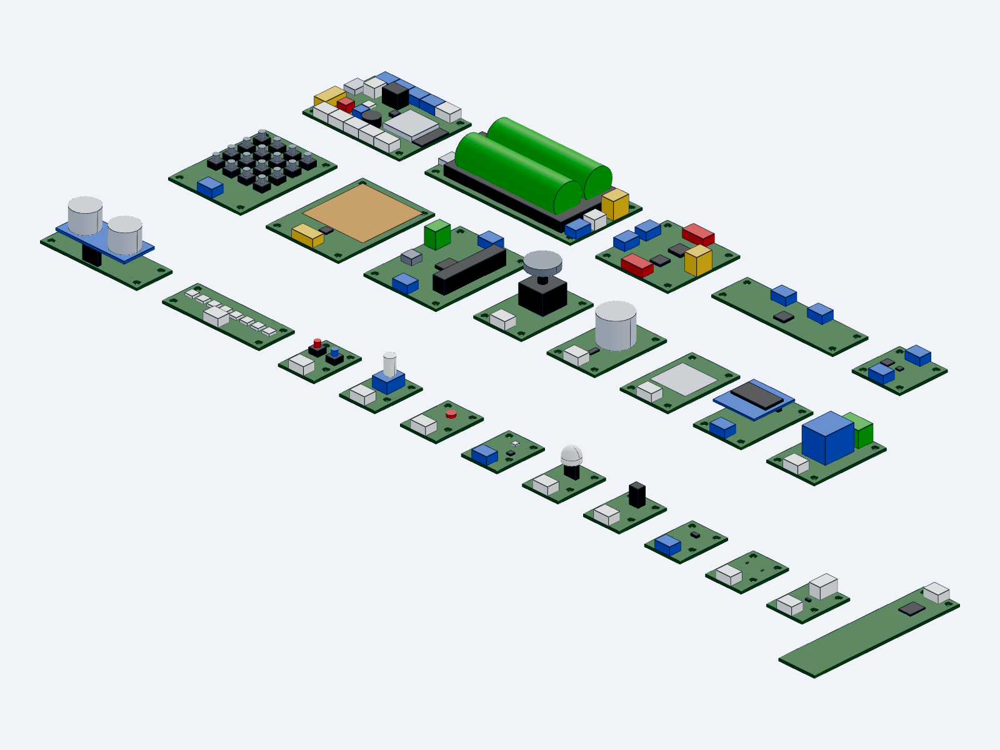
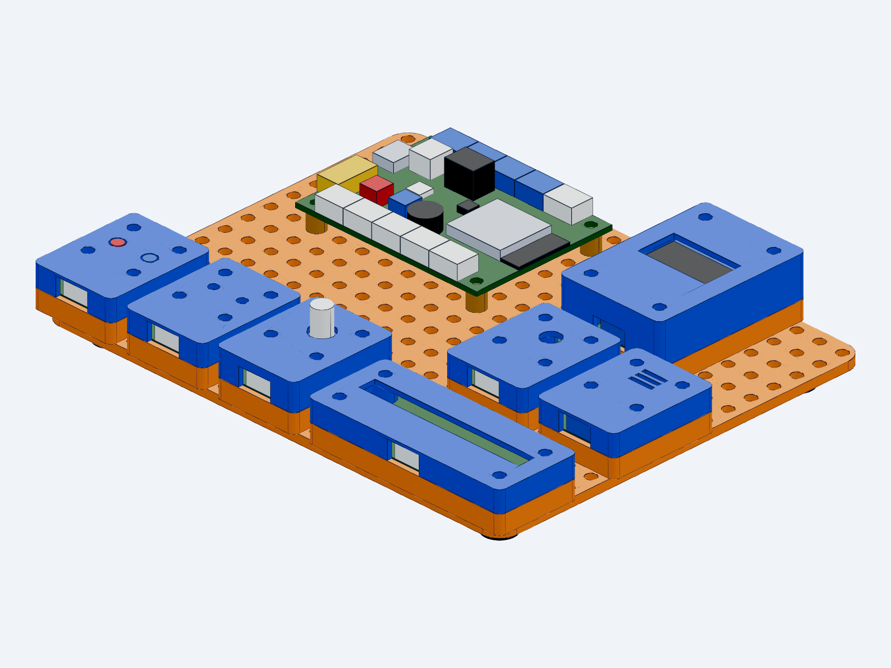
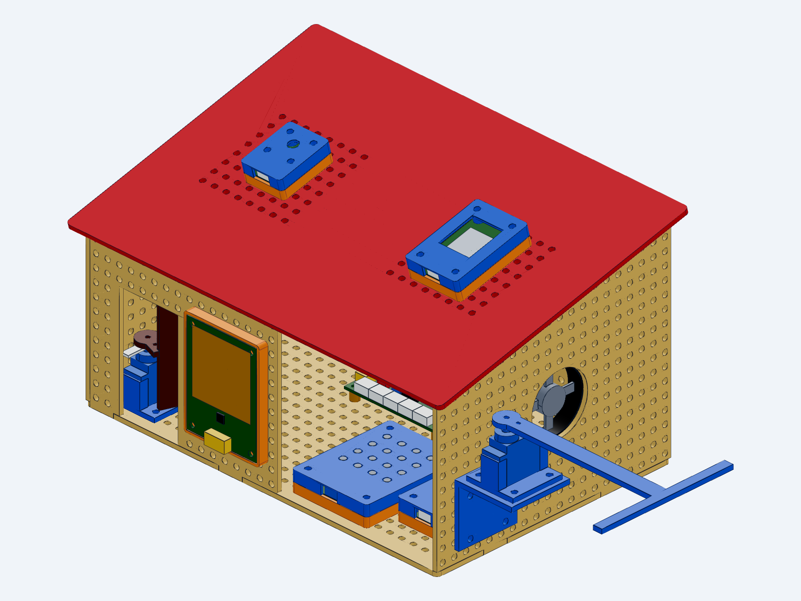
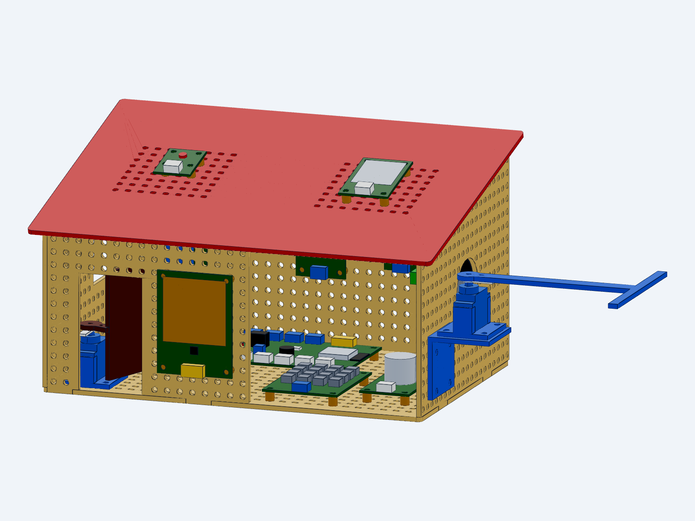
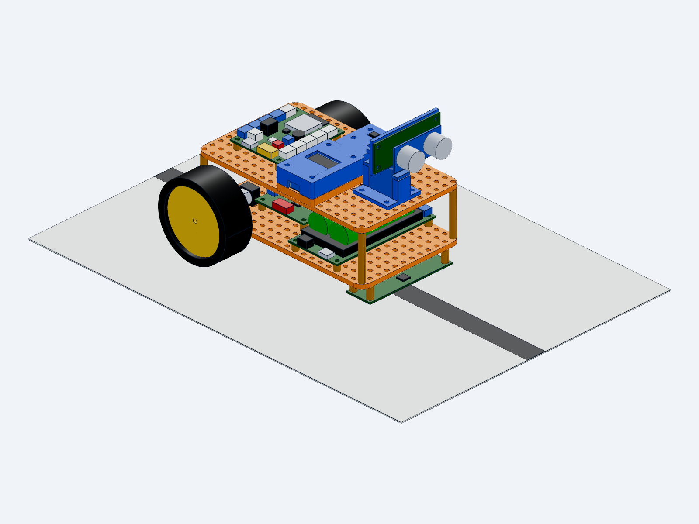
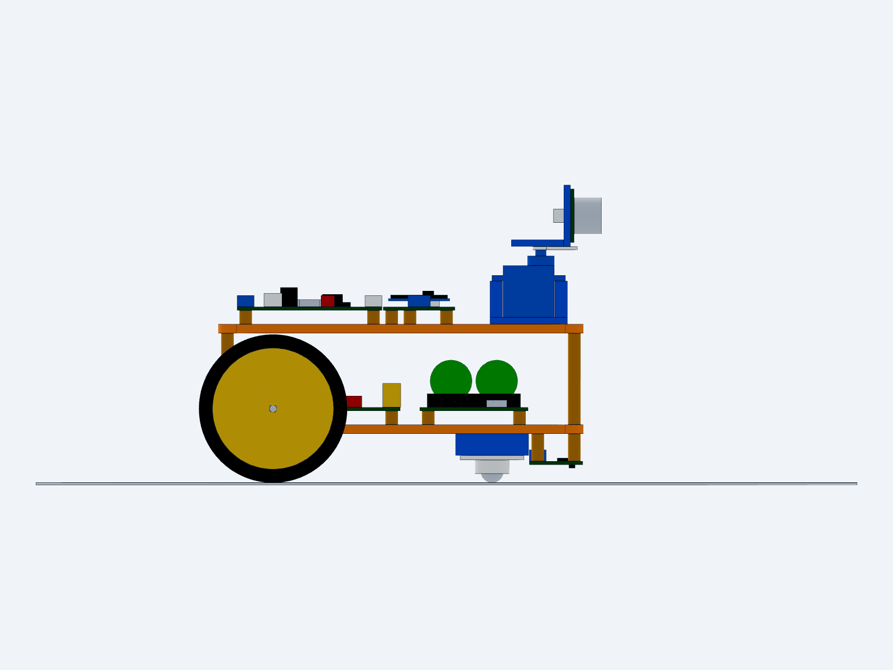
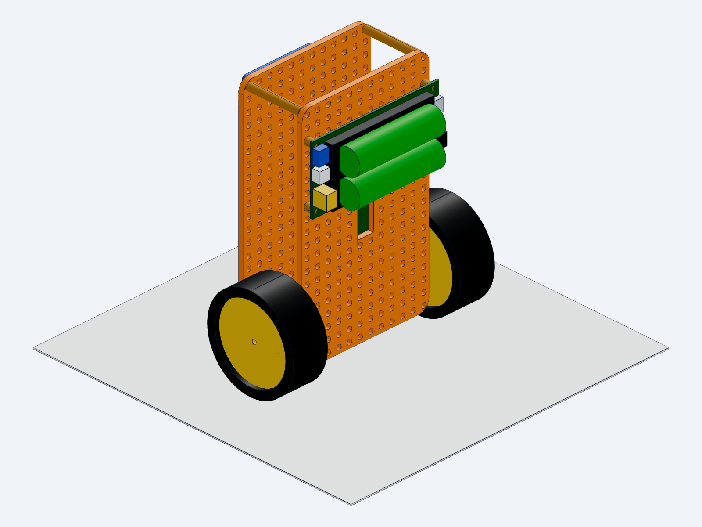
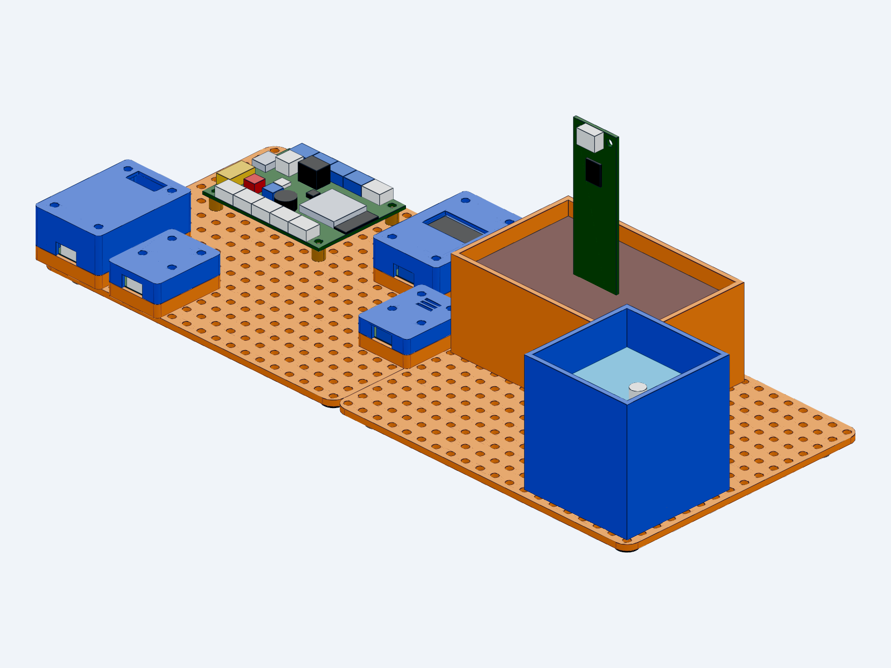
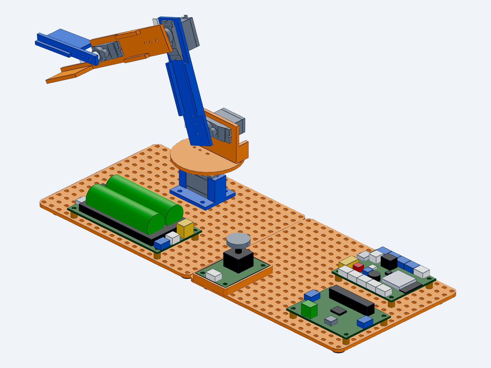
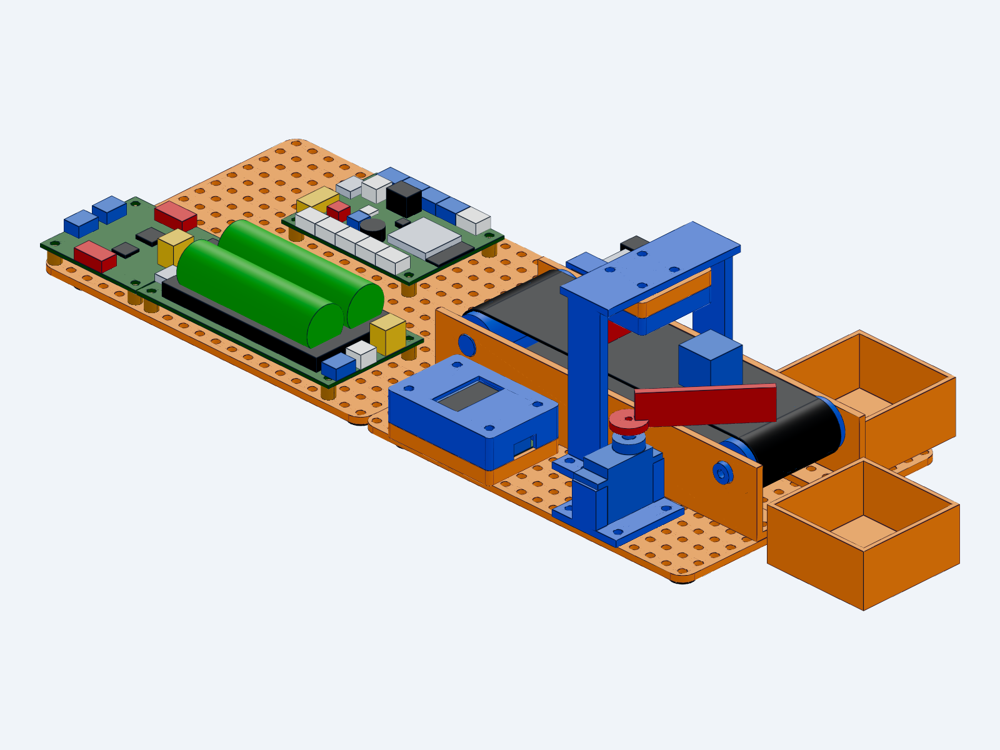

# Thiết kế cơ khí – kiểu dáng, kích thước, vị trí lắp và mô hình 3D

Phiên bản 0.1. Tài liệu này bổ sung cho [THIET-KE-HE-THONG.md](THIET-KE-HE-THONG.md): chốt hình dáng và kích thước các bo mạch phải tự thiết kế, các chi tiết phải vẽ và in 3D (hoặc cắt laser), và cách lắp chúng thành mô hình của từng dự án.

Mọi con số ở đây đều lấy từ mô hình CAD tham số trong [mechanical/src](../mechanical/src/README.md). Sửa số trong mã rồi dựng lại là tài liệu, tệp STEP và tệp STL in 3D cùng đổi theo. Đơn vị là mm.

## 1. Giả định đã dùng

Các điểm dưới đây tôi tự chọn để có thể dựng mô hình. Điểm nào không hợp thì đổi trong `mechanical/src/lib/` rồi dựng lại.

- Bản mặc định dùng động cơ N20 và bánh Ø65 × 26. Bản JGA25-370 mới chỉ có gá động cơ, chưa có cụm xe (xem mục 7).
- Chi tiết nhỏ in 3D bằng máy khổ 180 × 180 trở lên. Chi tiết lớn nhất phải in là tấm 160 × 128.
- Nhà K3 cắt laser từ tấm 3 mm (gỗ dán hoặc mica). Sàn 240 × 160 không in vừa máy khổ nhỏ.
- Bắt vít M3 cho mọi mối ghép với tấm lưới. Bo mạch kê trên trụ M3 cao 6 mm.
- Servo là SG90 hoặc MG90S (cùng kích thước lắp).

## 2. Chuẩn cơ khí chung

| Hạng mục | Giá trị |
|---|---|
| Bước lưới | 8 mm theo cả hai chiều |
| Lỗ trên tấm in / cắt laser | Ø3,4 (thông vít M3) |
| Lỗ gá trên bo mạch | Ø3,2, 4 lỗ ở 4 góc, tâm lỗ cách mép danh nghĩa 4 mm (riêng cỡ S: xem mục 3.1) |
| Kích thước bo mạch (danh nghĩa) | bội số của 8 mm, nên khoảng cách lỗ gá cũng là bội số của 8 mm |
| Đường cắt bo mạch | thu vào 0,25 mm mỗi cạnh so với danh nghĩa (bo 24 × 32 cắt thành 23,5 × 31,5), để hai bo gá sát nhau hở 0,5 mm; lỗ gá không dời, nên tâm lỗ cách mép thật 3,75 mm |
| Trụ kê bo mạch | M3 × 6 mm |
| Dày tấm | 3 mm (bảng gá, tấm nhà, chi tiết in mỏng); 4 mm (tấm khung xe) |
| Vùng cấm linh kiện quanh lỗ gá | bán kính 3 mm (đầu vít và trụ Ø5,5) |

Quy tắc đặt bo lên tấm lưới: lưới của mọi tấm đối xứng qua tâm tấm. Một cụm có khoảng cách lỗ gá bằng số lẻ ô lưới (24, 40, 56, 72, 88 mm) phải đặt tâm tại bội số của 8 mm tính từ tâm tấm; số chẵn ô (16, 32, 48 mm) thì đặt tâm lệch 4 mm. Mã dựng mô hình tự kiểm tra điều này và báo lỗi nếu một lỗ gá không trùng lưới.

## 3. Bo mạch phải thiết kế

Gốc toạ độ trong mục này là **góc dưới bên trái của bo danh nghĩa**, X sang phải, Y lên trên. Đây là bố trí cơ khí sơ bộ để vẽ mạch: vị trí lỗ gá và đầu cắm là ràng buộc cần giữ, còn linh kiện bên trong được phép dịch khi đi dây.

### 3.1. Các cỡ bo

| Cỡ | Kích thước | Khoảng cách lỗ gá | Module |
|---|---|---|---|
| S | 24 × 32 | 16 × 16 | I1, I2, I5, I6, I7, I12, I14, O1, O5 |
| M | 32 × 48 | 24 × 40 | I3, I8, I10, O3, O4 |
| L | 48 × 64 | 40 × 56 | I4, I13, O7 |
| T (thanh) | 64 × 24 | 56 × 16 | I11, O2 |
| S3 | 32 × 32 | 24 × 24 | S3 |
| S1 | 48 × 48 | 40 × 40 | S1 |
| S2 | 80 × 24 | 72 × 16 | S2 |
| C2 | 96 × 48 | 88 × 40 | C2 |
| C1 | 64 × 48 | 56 × 40 | C1 |
| Que | 24 × 96 | 2 lỗ ở đầu trên, cách 16 | I9 |

Cỡ S có lỗ gá tại (4, 12), (20, 12), (4, 28), (20, 28): hai lỗ phía đầu cắm lùi lên cách mép dưới 12 mm, vì đầu PH 4 chân rộng 9,9 mm không lọt giữa hai trụ đỡ cách nhau 16 mm. Phần bo dài 12 mm phía đầu cắm vì thế nhô ra khỏi hai trụ đỡ.

Module cỡ S, M, L có một đầu JST PH nằm ngang ở giữa cạnh ngắn phía dưới, miệng quay ra ngoài, để dây đi ra một phía. Đầu 4 chân chiếm 9,9 × 7,5 mm, cao 5 mm; đầu 6 chân rộng 13,9 mm.

### 3.2. C1 – bo chủ, 64 × 48

| Thành phần | Vị trí |
|---|---|
| Lỗ gá | (4, 4), (60, 4), (4, 44), (60, 44) |
| 5 cổng D/A (A1, A2, A3, D1, D2) | cạnh dưới, tâm x = 12 / 22 / 32 / 42 / 52 (bước 10) |
| 4 cổng I2C | cạnh trên, tâm x = 12 / 22 / 32 / 42 |
| Cổng D/A thứ sáu (D3) | cạnh trên, tâm x = 52 |
| Cổng SPI 6 chân | cạnh trái, tâm y = 14,75 |
| USB-C | cạnh trái, tâm y = 32 |
| Cổng nguồn 5 V từ C2 (2 chân, loại cắm đứng) | trong lòng bo, tâm (12,5; 35,5) |
| Nút reset | (34, 27) |
| ESP32-S3-WROOM-1 | x từ 38,25 đến 63,75, y từ 15 đến 33; anten sát mép phải, không đi đồng bên dưới |
| Nút A, nút B | (14, 15), (24, 15) |
| Còi | (32,5; 13,5) |
| LED RGB | (19, 25) |
| Hàng rào servo 4 × 3 chân | tâm (26; 35,5), chiếm 10,2 × 7,6 |

Lý do bố trí: bo thu từ 96 × 64 xuống 64 × 48 nên giữa hai lỗ gá của mỗi cạnh dài chỉ còn 50 mm, vừa đủ 5 đầu PH 4 chân đặt sát nhau (bước 10 mm, hở 0,1 mm). Vì vậy cổng D/A thứ sáu lên cạnh trên cạnh 4 cổng I2C, cổng SPI sang cạnh trái, còn cổng nguồn 5 V đổi sang loại cắm đứng đặt trong lòng bo (cạnh trái không đủ chỗ cho cả SPI, USB-C và cổng nguồn khi tính cả vỏ đầu cáp USB rộng khoảng 12 mm). Anten vẫn hướng ra mép phải, xa pin và động cơ.

Bố trí này là khối bao cơ khí, **chưa có mạch in C1**. Phần lòng bo còn trống khoảng 30 × 32 mm cho nút, còi, LED, hàng rào servo và toàn bộ linh kiện nguồn, nên mạch in nhiều khả năng phải đặt linh kiện cả hai mặt; cần kiểm lại khi đi dây.

### 3.3. C2 – nguồn pin 2S, 96 × 48

| Thành phần | Vị trí |
|---|---|
| Lỗ gá | (4, 4), (92, 4), (4, 44), (92, 44) |
| Đế 2 cell 18650 | giữa bo, chiếm 77 × 41, cell nằm dọc theo cạnh dài; tổng cao khoảng 22 mm |
| USB-C sạc, công tắc | cạnh trái, y = 14 và y = 34 |
| XT30 ra 7,4 V | cạnh phải, y = 34 |
| Cổng 5 V ra bo chủ, cổng I2C (INA219) | cạnh phải, y = 20 và y = 9 |

### 3.4. S1 – driver động cơ, 48 × 48

| Thành phần | Vị trí |
|---|---|
| Lỗ gá | (4, 4), (44, 4), (4, 44), (44, 44) |
| 2 cổng I2C (vào, ra) | cạnh trái, y = 17 và y = 31 |
| 2 cổng động cơ 6 chân | giữa cạnh trên và giữa cạnh dưới, mỗi cổng quay về một động cơ |
| XT30 vào | cạnh phải, tâm (44, 24) |
| TB6612FNG, STM32G030 | (26, 30), (26, 17) |

### 3.5. S2 – dò line 8 mắt, 80 × 24

| Thành phần | Vị trí |
|---|---|
| Lỗ gá | (4, 4), (76, 4), (4, 20), (76, 20) |
| 8 mắt đọc, **mặt dưới** | hàng y = 5, x = 8,5 + 9 × n (n = 0..7), bước 9 mm, tổng bề ngang đọc 63 mm |
| 2 cổng I2C, mặt trên | cạnh trên, x = 28 và x = 52 |
| STM32G030, mặt trên | (40, 8) |

S2 treo dưới mũi xe bằng 4 trụ M3 × 12, mặt mắt đọc cách sàn 5,9 mm.

### 3.6. S3 – IMU, 32 × 32

Lỗ gá (4, 4), (28, 4), (4, 28), (28, 28). Hai cổng I2C ở giữa cạnh dưới và cạnh trên. Cảm biến đặt đúng tâm bo (16, 16), cạnh IC song song cạnh bo, để trục đo trùng trục xe. Cỡ này lớn hơn cỡ S vì cỡ S không đủ chỗ cho vi điều khiển cùng hai đầu cắm.

### 3.7. Hai module lệch cỡ chuẩn

- **I11 siêu âm** dùng cỡ thanh 64 × 24 thay vì cỡ M, vì hai đầu thu phát Ø16 cách nhau 26 mm không để lại chỗ cho vít ở cỡ M. Đầu cắm đặt ở **mặt sau**, chui qua ô 12 × 9 của gá.
- **I9 độ ẩm đất** là một que 24 × 96 cắm thẳng vào đất, đầu cắm ở đầu trên. Nó không gá lên lưới.

## 4. Chi tiết phải vẽ

Tệp nguồn ở `mechanical/src/chi_tiet/<tên>.py`, tệp in ở `mechanical/STL/<tên>.stl`. Kích thước bao là kết quả đo trên mô hình.

### 4.1. Dùng chung

| Chi tiết | Kích thước bao | Lỗ gá | Ghi chú |
|---|---|---|---|
| `tam_xe` | 160 × 96 × 4 | lưới 20 × 12 lỗ | K2. Bo góc R8, rãnh luồn dây 32 × 12 ở giữa. Mỗi xe dùng 2 tấm giống nhau |
| `bang_ga` | 160 × 128 × 3 | lưới 20 × 16 lỗ | Bảng gá thực hành. Hai bảng đặt sát nhau thì lưới liền mạch |
| `thanh_noi` | 32 × 16 × 3 | 8 lỗ theo lưới | Nối hai bảng gá, bắt ở mặt dưới |
| `ga_servo` | 34 × 32 × 18,9 | 4 lỗ, 24 × 24 | Servo đứng, trục ra hướng lên. Hai trụ đỡ tai servo, lỗ mồi Ø1,8 cách 27,8 |
| `ke_goc` | 40 × 39 × 39 | 4 lỗ 24 × 24 ở mỗi mặt | Tạo một kệ ngang trên tường đứng |

### 4.2. Cụm truyền động K1 và khung xe K2

| Chi tiết | Kích thước bao | Lỗ gá | Ghi chú |
|---|---|---|---|
| `ga_n20` | 32 × 10 × 14 | 2 lỗ cách 24 | Kẹp hộp số N20 trong hốc 12,3 × 10,3; tâm trục cao 7 mm trên mặt gá |
| `ga_jga25` | 40 × 27 × 32 | 4 lỗ, 32 × 8 | Chữ L; mặt đứng có lỗ trục Ø7,5 và 2 lỗ M3 cách 17; tâm trục cao 16 mm |
| `de_mat_trau` | 32 × 16 × 9,5 | 4 lỗ, 24 × 8 | Đệm để mắt trâu cao 12 mm chạm đất đúng lúc xe nằm ngang |
| `ga_sieu_am` | 26 × 64 × 27 | bắt vào cần servo | Mặt đứng giữ bo I11, 4 lỗ 56 × 16 |

### 4.3. Nhà K3 (cắt laser 3 mm)

| Chi tiết | Kích thước bao | Ghi chú |
|---|---|---|
| `nha_san` | 240 × 160 | Lưới 8 mm toàn sàn, chừa viền 8 mm; 9 rãnh mộng 16,2 × 3,2 |
| `nha_tuong_sau` | 234 × 135 (+3 mộng) | Lưới 29 × 16 lỗ; 3 mộng đáy |
| `nha_tuong_trai` | 160 × 96 đến 136 (+3 mộng) | Hình thang theo độ dốc mái; cửa sổ 40 × 40 |
| `nha_tuong_phai` | 160 × 96 đến 136 (+3 mộng) | Đối xứng tường trái; lỗ quạt Ø38, quạt 40 × 40 bắt vào 4 lỗ lưới cách 32 |
| `nha_vach_truoc` | 128 × 96 (+3 mộng) | Ô cửa 40 × 72; vùng gá đầu đọc RFID bên phải cửa |
| `nha_mai` | 256 × 176 | Mái dốc một chiều 14°; hai vùng lỗ gá cảm biến mưa và ánh sáng |
| `nha_canh_cua` | 46 × 22 × 67 | In 3D. Gắn lên cần servo; cánh lệch 14 mm so với trục để mở vào trong |
| `gian_phoi` | 117 × 90 × 3 | In 3D. Chữ T gắn lên cần servo, quay ngang ra dưới mái hiên |

Nửa phải mặt trước để hở để học sinh nhìn và thao tác bên trong.

### 4.4. Vườn, cánh tay robot, băng tải (K4)

| Chi tiết | Kích thước bao | Lỗ gá | Ghi chú |
|---|---|---|---|
| `khay_cay` | 96 × 64 × 44 | 4 lỗ, 80 × 48 | Thành 2,4 mm |
| `binh_nuoc` | 56 × 56 × 60 | 4 lỗ, 40 × 40 | Chứa bơm chìm mini Ø24 |
| `tay_de` | 38 × 32 × 21,8 | 4 lỗ, 24 × 24 | Gá servo đế MG90S đứng; hai trụ đỡ tai cao 18,8, khe vít tai, rãnh thoát dây |
| `tay_mam_xoay` | Ø56 × 35 | bắt vào cần servo đế | Vách đứng có ô 23,1 × 12,4 lắp servo vai MG90S; trục vai cao 25 mm; hai gân chống ở mặt sau |
| `tay_khau_1` | 102 × 7 × 22 | – | Bắp tay, 80 mm giữa hai trục; hai gân dọc; đầu xa lắp servo khuỷu MG90S |
| `tay_khau_2` | 131 × 27 × 22 | – | Cẳng tay, 64 mm giữa hai trục; hai gân dọc; đầu xa lắp servo kẹp MG90S và hàm kẹp cố định |
| `tay_kep_ngon` | 62 × 27 × 8 | – | Ngón kẹp động gắn lên cần servo kẹp |
| `bt_thanh_ben` | 160 × 15 × 30 | 20 lỗ theo lưới | Dùng 2 thanh giống nhau, thanh kia xoay 180°; 2 lỗ Ø8,4 đỡ con lăn, cách nhau 128 |
| `bt_con_lan` | Ø20 × 56,5 | – | 2 con; ngõng dài có lỗ Ø3,2 nhận trục N20 |
| `bt_cong_mau` | 24 × 82 × 69 | 4 lỗ chân, 8 × 72; 4 lỗ gá I14, 16 × 16 | Giữ bo I14 úp xuống, cách mặt băng 24 mm |
| `bt_can_gat` | 59 × 14 × 14 | – | Lá gạt gắn lên cần servo |
| `bt_khay` | 48 × 48 × 24 | – | 2 khay hứng |

### 4.5. Số lượng in cho từng mô hình

| Mô hình | Chi tiết in |
|---|---|
| Bàn thực hành | 1 `bang_ga` |
| Xe dò line | 2 `tam_xe`, 2 `ga_n20`, 1 `de_mat_trau`, 1 `ga_servo`, 1 `ga_sieu_am` |
| Xe cân bằng | 2 `tam_xe`, 2 `ga_n20` (dùng lại của xe dò line) |
| Nhà thông minh | 2 `ga_servo`, 1 `ke_goc`, 1 `nha_canh_cua`, 1 `gian_phoi` + 6 tấm cắt laser |
| Vườn thông minh | 2 `bang_ga`, 2 `thanh_noi`, 1 `khay_cay`, 1 `binh_nuoc` |
| Cánh tay robot | 2 `bang_ga`, 2 `thanh_noi`, 1 `tay_de`, 1 `tay_mam_xoay`, 1 `tay_khau_1`, 1 `tay_khau_2`, 1 `tay_kep_ngon` |
| Băng tải | 2 `bang_ga`, 2 `thanh_noi`, 2 `bt_thanh_ben`, 2 `bt_con_lan`, 1 `ga_n20`, 1 `bt_cong_mau`, 1 `ga_servo`, 1 `bt_can_gat`, 2 `bt_khay` |

Nếu tháo lắp dùng lại giữa các dự án, một bộ kit cần 2 `tam_xe`, 2 `bang_ga`, 2 `thanh_noi`, 2 `ga_servo`, 2 `ga_n20` và mỗi chi tiết còn lại một cái (riêng `bt_thanh_ben`, `bt_con_lan`, `bt_khay` mỗi loại hai cái). Muốn bày đồng thời mọi mô hình thì cần 5 `ga_servo`, 3 `ga_n20` và 7 `bang_ga`.

### 4.6. Vỏ bo mang (đế + nắp)

Mỗi bo mang có một đế và một nắp in 3D, mô hình trong `mechanical/src/vo/`, hàm dựng ở `lib/vo.py`. Thông số từng bo (chiều cao nắp, lỗ khoét, khe đầu cắm) nằm trong `hardware/bo-mang/bo_tri.py`, cùng tệp mà bộ dựng PCB dùng để đặt linh kiện.

- Chồng lắp: đầu vít M3 – nắp – bo – đế – tấm gá – đai ốc. Trụ Ø6,4 của nắp ép lên mặt bo, trụ của đế đỡ mặt dưới; lỗ thông Ø3,4.
- Thành và sàn dày 1,6 mm; khe quanh bo 0,4 mm; dưới bo trống 3 mm cho chân linh kiện (I11: 8,5 mm và có lỗ trên sàn cho đầu cắm mặt sau).
- Kích thước ngoài lớn hơn kích thước danh nghĩa của bo 1,75 mm mỗi cạnh, nên hai module có vỏ đặt cạnh nhau phải cách thêm một bước lưới 8 mm.
- Chiều dài vít: lòng nắp + 7,8 mm (nắp 1,6 + bo 1,6 + đế 4,6) cộng bề dày tấm gá và đai ốc. Nắp thấp (lòng 5,4) trên tấm 3 mm dùng M3 × 20.
- Nắp in úp (mặt trên xuống bàn in), đế in ngửa; không cần đỡ. STL: `mechanical/STL/vo/`.
- I3 và I13 chỉ có đế: module joystick và RC522 rộng hơn khoảng giữa 4 vít.
- I9: vỏ chỉ ôm phần đầu bo (từ y = 12 trở lên), que cắm đất thò ra qua khe ở thành dưới.
- Module cắm rời (OLED, HC-SR04, AM312) ngồi trên hàng rào cái cao 8,5 mm, nên nắp O3 có lòng 11,6 mm và nắp I11 có lòng 13,8 mm.
- Kiểm khớp: `hardware/bo-mang/xuat_step.py` xuất mô hình 3D thật của từng PCB từ KiCad, `mechanical/src/kiem_vo.py` đo phần vỏ cắt vào từng linh kiện. Kết quả hiện tại: không bo nào giao nhau. KiCad không có mô hình 3D cho biến trở, LDR, MQ-2 và các module cắm rời, nên lỗ khoét của những linh kiện này chỉ được đối chiếu theo toạ độ đặt.
- Mô hình bo trong `lib/mach.py` đã cập nhật theo vị trí linh kiện trên PCB. Trong các cụm dự án, bo mang được gắn cùng vỏ: đế đặt thẳng lên mặt gá thay cho 4 trụ đỡ, mặt dưới bo cao 4,6 mm (I11: 10,1 mm).
- Kiểm va chạm: `mechanical/src/kiem_va_cham.py` đo thể tích giao nhau giữa mọi cặp khối trong 7 cụm dự án. Sau khi dời 7 module (bàn thực hành: I6, I5, O1, I2; nhà: C1, O3; xe dò line: O3; vườn: I6), không còn va chạm nào. Ba cặp giao nhau còn lại là cố ý: bi trong vỏ mắt trâu, bơm trong nước, que I9 trong đất.
- Sau khi sửa `bo_tri.py` phải dựng lại vỏ với `--force`: cadgen không theo dõi tệp này.
- Lỗ khoét trên nắp lấy theo kích thước danh nghĩa của linh kiện và module; phải in thử và ướm với linh kiện thật trước khi in loạt.

## 5. Linh kiện mua sẵn

Dựng dạng khối bao theo kích thước phổ biến, chỉ để kiểm tra lắp ráp. Phải đo lại hàng thực tế trước khi in hàng loạt.

| Linh kiện | Kích thước đã dùng |
|---|---|
| Động cơ N20 có encoder | hộp số 12 × 10 × 9, thân dài 15, encoder dài 8, trục Ø3 × 10 |
| Động cơ JGA25-370 có encoder | Ø25, dài 64 không kể trục, trục Ø4 × 12 |
| Bánh xe | Ø65 × 26, lỗ trục 3 mm |
| Bánh mắt trâu mini | cao 12 |
| Servo SG90 | thân 22,5 × 12,2 × 22,7; tai dài 32,3, đáy tai cao 15,9; trục lệch tâm 5,35; mặt cần cao 31 |
| Quạt | 40 × 40 × 10, lỗ 32 × 32 |
| Bơm chìm mini | Ø24 × 33 |
| Trụ M3 | 6, 12, 15, 40 mm |
| Dây băng tải | vòng kín rộng 40, dày 1, chu vi khoảng 320 (in TPU hoặc cắt từ dây cao su) |

## 6. Mô hình 3D của các dự án

Tệp STEP nằm ở `mechanical/STEP/du_an/`. Toạ độ (u, v) là vị trí tâm cụm tính từ tâm tấm.

### 6.1. Bàn thực hành – dự án 1–4, 17, 19, 20

Một `bang_ga` 160 × 128 trên 4 chân cao su. Các dự án khác nhau chỉ đổi module ở hai hàng dưới và bên phải.

| Module | (u, v) |
|---|---|
| C1 | (-32, 32) |
| O3 OLED | (40, 40) |
| I6 nhiệt ẩm | (68, -8) |
| I1 nút bấm | (-68, -48) |
| O1 LED | (-36, -48) |
| I2 biến trở | (-4, -48) |
| I5 ánh sáng | (36, -8) |
| O2 NeoPixel | (48, -52) |

### 6.2. Nhà thông minh – dự án 5–10

Kích thước tổng khoảng 256 × 171 × 143 (không kể giàn phơi). Mô hình là cấu hình đầy đủ của dự án 10; các dự án 5–9 dùng một phần.

| Vị trí | Module và cách gá |
|---|---|
| Sàn | C1 tại (0, 32); I8 khí gas tại (88, -32); I4 bàn phím tại (40, -40); servo cửa trong `ga_servo` tại (-96, -56) |
| Tường sau, mặt trong | O3 màn hình (4, -8); O1 đèn (0, 40); I7 chuyển động (-48, 32); I6 nhiệt ẩm (56, 0); O4 relay (-84, -16) |
| Tường phải, mặt trong | quạt 40 × 40 trước lỗ Ø38; O5 MOSFET bên cạnh |
| Tường phải, mặt ngoài | `ke_goc` cao 47 mm, trên đó là `ga_servo` và `gian_phoi` |
| Vách trước, mặt ngoài | I13 RFID bên phải ô cửa |
| Mái | I10 cảm biến mưa (64, 0); I5 ánh sáng (-60, 0) |

Trục servo cửa cách mặt trong vách trước 15,7 mm, ngang mép ô cửa. Cánh cửa mở vào trong 90° mà không chạm gá servo.

### 6.3. Xe dò line – dự án 11–16

Hệ toạ độ xe: +X là đầu xe, gốc ở tâm tấm đế. Kích thước xe khoảng 177 dài × 152 rộng (kể cả bánh) × 131 cao (tới đỉnh gá siêu âm).

| Hạng mục | Giá trị |
|---|---|
| Trục bánh | x = -56; tâm trục cao 7 mm trên mặt tấm đế |
| Khoảng cách tâm hai bánh | 126 mm |
| Gầm xe (mặt dưới tấm đế tới sàn) | 21,5 mm |
| Mắt trâu | dưới tấm đế tại x = 40, trên `de_mat_trau` |
| S2 | dưới mũi xe tại x = 68, treo bằng trụ 12 mm; hàng mắt đọc cách trục bánh 131 mm |
| Tấm đế, mặt trên | `ga_n20` tại (-56, ±44); S1 tại (-24, 0); C2 tại (32, 0) |
| Trụ giữa hai tấm | 4 trụ M3 × 40 ở (±76, ±44) |
| Tấm trên | C1 tại (-40, 0); O3 tại (16, -24); I12 tại (12, 24); servo siêu âm tại (56, 0) |

Dự án 11 chỉ cần khung, K1, S1, C1, C2 và I12. Dự án 12 thêm servo và siêu âm; 13–14 thêm S2 và O3; 15 thêm S3; 16 thêm I13.

### 6.4. Xe cân bằng – dự án 21–22

Cùng khung K2 dựng đứng, đúng ý "lắp ngang là xe dò line, lắp đứng là xe cân bằng". Khi chuyển từ xe dò line:

1. Tháo mắt trâu, S2, servo siêu âm.
2. Chuyển C2 từ mặt trong sang **mặt ngoài tấm đế**, tại (40, 0). Pin là khối nặng nhất; đặt ở mặt đối diện với tấm trên kéo trọng tâm về gần mặt phẳng chứa trục bánh, và ở cao 96 mm trên trục để xe dễ giữ thăng bằng.
3. Gắn S3 lên tấm trên tại (8, 0), O3 tại (48, 0).

Xe cao 168 mm, rộng 152 mm.

### 6.5. Vườn thông minh – dự án 18

Hai `bang_ga` nối nhau. Bảng mạch: C1 (-32, 32), O3 (40, 40), I6 (68, -8), O4 (-64, -40), O5 (-28, -48). Bảng vườn: `khay_cay` tại (-28, 28) có que I9 cắm trong đất; `binh_nuoc` tại (48, -32) chứa bơm.

### 6.6. Cánh tay robot – dự án 23

Bốn servo MG90S: đế xoay, vai, khuỷu, kẹp. Tầm với 80 + 64 mm, cộng 56 mm hàm kẹp. Mỗi khâu là một tấm phẳng dày 3 mm có hai gân dọc 3 × 4; servo của khớp kế tiếp lắp xuyên qua ô 23,1 × 12,4 ở đầu xa và bắt bằng hai vít tai, nên mỗi khớp lệch sang ngang 15,4 mm so với khớp trước.

Kích thước lắp lấy từ mô hình 3D của MG90S (`mechanical/STEP/mua_san/adafruit_1143_micro_servo_high_torque_metal_gear.step`, tải từ step.parts; Adafruit 1143 chính là MG90S):

| Kích thước | MG90S (mô hình) | SG90 (bản cũ) |
|---|---|---|
| Thân | 22,6 × 12,0 | 22,5 × 12,2 |
| Đáy tai so với đáy thân | 18,8 | 15,9 |
| Hai lỗ tai cách nhau | 29,6 | 27,8 |
| Trục lệch tâm thân | 5,3 | 5,35 |
| Mặt cần servo tới mặt dưới tai | 12,4 | 15,1 |

- Lỗ vít tai là khe dài 3 mm, nhận khoảng cách lỗ từ 27,2 đến 29,6 mm, phòng servo mua về lệch so với mô hình.
- `tay_de` thay `ga_servo` ở đế: trụ đỡ tai cao 18,8 mm, có rãnh thoát dây ở chân trụ phía trục.
- Mô men MG90S khoảng 1,8 kg·cm ở 4,8 V. Ở tầm với lớn nhất 20 cm, servo vai phải gánh hai servo phía ngoài (2 × 13,4 g ở 8 và 14,4 cm ≈ 0,3 kg·cm) cùng các khâu nhựa, nên tải gắp thực tế chỉ nên vài chục gam; con số chính xác phải đo trên bản mẫu.
- Mặt ngoài cần servo lấy ở 12,4 mm trên mặt dưới tai (cần dày 4 mm lồng lên trục răng); đo lại với cần thật trước khi in loạt.

Bảng tay: `tay_de` tại (0, 32), C2 tại (0, -40). Bảng mạch: C1 (32, 32), O7 (48, -32) xoay 90°, I3 joystick (-56, -40).

### 6.7. Băng tải phân loại màu – dự án 24

| Hạng mục | Giá trị |
|---|---|
| Hai con lăn | x = ±64, tâm trục cao 22 mm trên mặt bảng |
| Mặt băng | rộng 40, cao 33 mm trên mặt bảng |
| Hai thanh bên | mặt trong ở y = ±24, chân đế quay vào trong, bắt ở hàng lỗ y = ±20 |
| Động cơ N20 | cạnh con lăn x = -64, trên `ga_n20` kê bằng 2 trụ M3 × 15 để đồng trục với con lăn |
| Cổng cảm biến màu | x = 0, I14 úp xuống |
| Servo gạt | `ga_servo` tại (32, -48); lá gạt quét ngay trên mặt băng, đẩy vật sang khay ở (52, 52) |
| Bảng mạch | C1 (0, 32), C2 (16, -40), S1 (-56, -40); O3 gắn trên bảng băng tải tại (-40, -48) |

### 6.8. Dự án chưa có mô hình riêng

- Dự án 15 (xe vẽ hình) cần một gá bút nâng hạ bằng servo ở tâm trục bánh. Chưa thiết kế.
- Dự án 16 (xe giao hàng) dùng mô hình xe dò line, thêm I13 trên tấm trên; chưa đặt vào mô hình.
- Dự án 25 là dự án mở.

## 7. Bản động cơ JGA25-370

Hai động cơ JGA25-370 nối đuôi nhau dài khoảng 128 mm, không lọt bề ngang 96 mm của `tam_xe`. Hướng xử lý đề xuất là xoay tấm 90° để trục bánh nằm dọc cạnh 160 mm, dùng `ga_jga25` thay `ga_n20`. Khi đó tâm trục cao 16 mm thay vì 7 mm, nên đệm mắt trâu và trụ treo S2 phải dài thêm 9 mm. Phương án này chưa dựng thành mô hình.

## 8. Kiểm tra đã chạy

- Cả 28 chi tiết và 8 cụm dựng thành công; `cadgen step inspect validate` báo mọi khối kín, hợp lệ, thể tích dương.
- Mã dựng kiểm tra từng lỗ gá của từng module có trùng lưới 8 mm hay không; bước này đã bắt và tôi đã sửa 2 vị trí đặt lệch.
- Kiểm tra giao nhau giữa mọi cặp khối trong 7 cụm dự án: đã sửa 3 va chạm thật (thanh nối đè chân đế, vòm PIR lún vào bo, ngõng con lăn chạm khay). Các giao nhau còn lại là cố ý: pin nằm trong đế pin, bi trong vỏ mắt trâu, bơm trong nước, que trong đất.
- Đã xem ảnh chụp của từng cụm.

## 9. Giới hạn

- Chưa in thử chi tiết nào. Dung sai lắp (hốc kẹp N20, ô servo, lỗ trục con lăn, mộng nhà) phải chỉnh sau lần in đầu.
- Khối bo mạch là khối bao, chưa phải bản vẽ mạch. Bố trí linh kiện mục 3 chưa được kiểm bằng việc đi dây thật.
- Kích thước linh kiện mua sẵn lấy theo thông số phổ biến, chưa đo trên hàng thực.
- Nhà K3 mới có mộng giữa tường và sàn. Mối ghép tường với tường và tường với mái chưa chi tiết hoá, và chưa xuất bản cắt DXF.
- Mô hình không có dây điện, ống nước, vít.
- Chưa tính độ cứng của cánh tay và mô-men servo.
