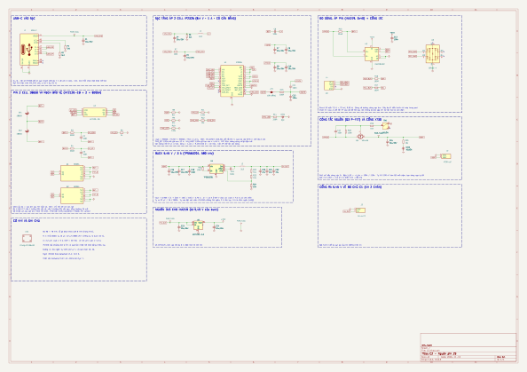

# C2 – Nguồn pin 2S: tài liệu thiết kế chi tiết

Phiên bản 0.1 – 16/11/2026. Viết theo sơ đồ [C2.kicad_sch](C2.kicad_sch) (70 linh kiện, ERC 0 lỗi). **Chưa có mạch in, chưa có bản mẫu.** Mạch quanh HY2120-CB và 8205A vẽ theo trí nhớ, **chưa đối chiếu datasheet** (mục 12).

Tài liệu liên quan: [THIET-KE-MACH.md](../THIET-KE-MACH.md) mục 1, 7; [THIET-KE-CO-KHI.md](../../docs/THIET-KE-CO-KHI.md) mục 3.3.



## 1. Vai trò và thông số chính

C2 cấp điện cho các dự án di động: 5 V cho bo chủ, điện áp pin cho động cơ và servo, và báo điện áp, dòng pin qua I2C.

| Hạng mục | Giá trị |
|---|---|
| Pin | 2 cell 18650 nối tiếp (6,0–8,4 V; danh định 7,4 V) |
| Kích thước | 96 × 48 mm, 4 lỗ gá Ø3,2 tại (4, 4), (92, 4), (4, 44), (92, 44); cao khoảng 22 mm cả pin |
| Sạc | USB-C, sạc tăng áp 2 cell bằng IP2326, 1,0 A, có cân bằng cell, hẹn giờ 12 h |
| Ra động lực | `VBAT` (bằng điện áp pin) qua XT30 cái, đỉnh 7,2 A |
| Ra 5 V | 5,45 V, 2 A liên tục, 3 A đỉnh ngắn, qua JST XH 2 chân về C1 |
| Đo | INA219 tại địa chỉ I2C 0x40: điện áp pin, dòng sạc (âm) và dòng xả (dương) |
| Bảo vệ | quá sạc, quá xả, quá dòng (HY2120-CB + 2 × 8205A) |
| Công tắc | gạt, điều khiển P-MOSFET; sạc được khi công tắc tắt |

## 2. Sơ đồ khối

```
 J1 USB-C ─ VIN_CHG ─► L1 ─► U1 IP2326 ─► VPACK ─┬─ R15 shunt 10 mΩ ─ BAT+ ─ BT1 ─ BATM ─ BT2 ─ BAT−
                              │ cân bằng          │        (U3 INA219)                           │
                              └─ R13, JP1 ─ BATM  │                          U2 HY2120-CB ─► Q1 ∥ Q2 (8205A)
                                                  │                                              │
                                 SW1 ─► Q3 AO4435 ┘                                             GND
                                          │
                                        VBAT ─┬─► J2 XT30 cái
                                              └─► U4 TPS563201 ─► 5V_OUT (5,45 V) ─┬─► J3 XH 2 chân (về C1)
                                                                                   └─► U5 AP2112K ─► +3V3 (U3)
 J4 cổng I2C: chỉ GND, SDA, SCL (chân 5 V để hở)
```

Tên lưới: `BAT+`, `BATM`, `BAT−` là ba cực của bộ pin; `VPACK` là cực dương sau shunt (nơi mạch sạc và tải nối vào); `GND` của bo là cực âm **sau** FET bảo vệ; `VBAT` là điện áp sau công tắc.

## 3. Cổng và thứ tự chân

| Ký hiệu | Cổng | Đầu cắm | Chân |
|---|---|---|---|
| J1 | USB-C sạc | HRO TYPE-C-31-M-12 | VBUS, D+, D− (về IP2326), CC1 và CC2 mỗi chân 5k1 |
| J2 | Ra động lực | XT30 cái | 1 GND, 2 VBAT |
| J3 | Ra 5 V về C1 | JST XH 2 chân | 1 GND, 2 5V |
| J4 | I2C | JST PH 4 chân | 1 GND, 2 để hở, 3 SDA, 4 SCL |
| BT1, BT2 | Đế pin | 2 × Keystone 1042 (1 cell 18650) | BT1 là cell trên (`BAT+`–`BATM`), BT2 là cell dưới |

Chân 5 V của J4 **phải để hở**: nếu nối vào đường 5 V của C2, nó đi tắt qua D1 và cầu chì của C1.

## 4. Mô tả từng khối

### 4.1. USB-C vào sạc

| Linh kiện | Giá trị | Vai trò |
|---|---|---|
| R1, R2 | 5k1 | CC1, CC2 xuống GND |
| C1, C4 | 10 µF 25 V | tụ trên `VIN_CHG` (sát đầu USB và sát L1) |
| R6 | 5k1 xuống GND | tải nhỏ trên `VIN_CHG`, vẽ theo sơ đồ mẫu của datasheet |

D+ và D− nối thẳng về IP2326 để IC xin điện áp cao hơn từ bộ sạc nhanh (tối đa khoảng 7 V khi pin trên 7,8 V). Vì vậy mọi linh kiện trên `VIN_CHG` dùng loại 25 V.

### 4.2. Sạc tăng áp IP2326

Vẽ theo datasheet V1.2, hình 5.

| Chân | Tên | Nối tới | Ý nghĩa |
|---|---|---|---|
| 1, 2 | DM, DP | D−, D+ của J1 | xin sạc nhanh |
| 3 | VSET | để hở | điện áp sạc 8,4 V |
| 4 | NTC | R9 51 k xuống GND | không dùng nhiệt điện trở |
| 5 | BAT_STAT | để hở | – |
| 6 | LED | R14 330 Ω + LED1 | báo sạc |
| 7 | TIME_SET | R10 120 k | hết giờ sau 12 h |
| 8 | VIN_UVSET | R11 120 k | giữ điện áp vào không tụt dưới 4,45 V |
| 9 | VIN_OVSET | để hở | ngắt khi điện áp vào quá 8,75 V |
| 10 | CON_SEL | để hở | chế độ 2 cell |
| 11 | ISET | R8 91 k | dòng sạc = 90000 / 91 k ≈ 1,0 A |
| 12 | EN | R12 10 k lên `CHG_VIN` | luôn cho phép |
| 13 | VIN | `VIN_CHG` qua R7 0,5 Ω, tụ C5 10 µF | nguồn nuôi IC, đã lọc |
| 14 | BST | C6 100 nF về LX | tụ bootstrap |
| 15–17 | LX | L1 2,2 µH từ `VIN_CHG` | nút đóng cắt |
| 18, 25 | PGND, pad tản nhiệt | GND | |
| 19, 20 | VSYS | C7, C8 22 µF 25 V | tụ đầu ra tầng tăng áp |
| 21, 22 | VOUT | `VPACK`, C9, C10 10 µF 25 V | ra pin |
| 23 | VBATM | `BATM` qua JP1 và R13 100 Ω (1206); C11 100 nF lên `VPACK`, C12 100 nF xuống GND | đo và cân bằng điểm giữa |
| 24 | VBAT_GND | GND | |

Tính toán:

- **Dòng sạc 1,0 A** thay cho 1,5 A: IC toả khoảng 0,6 W thay vì 1,2 W. Pin 2600 mAh sạc khoảng 3,5 giờ.
- **Công suất vào**: 8,4 V × 1,0 A ≈ 8,4 W ra pin, tức khoảng 1,9 A ở 5 V nếu hiệu suất 90 %. Với nguồn yếu hơn (cổng USB máy tính 0,5 A), mạch giữ áp vào 4,45 V tự giảm dòng sạc. Cần đo dòng vào thực tế với adapter 5 V/2 A.
- **Cân bằng**: mở ở 4,1 V mỗi cell, dòng = V_cell / R13 = 4,1 / 100 ≈ 40 mA; R13 toả 0,17 W nên dùng vỏ 1206. Cắt JP1 để tắt cân bằng.
- **L1**: 2,2 µH, dòng bão hoà từ 5 A, điện trở dây dưới 20 mΩ.

### 4.3. Pin và mạch bảo vệ

| Linh kiện | Giá trị | Vai trò |
|---|---|---|
| U2 | HY2120-CB, SOT-23-6 (LCSC C116509) | giám sát 2 cell: quá sạc, quá xả, quá dòng |
| R3 + C2 | 330 Ω + 100 nF | lọc `BAT+` → chân VDD (5); tụ về `BAT−` |
| R4 + C3 | 330 Ω + 100 nF | lọc `BATM` → chân VC (4); tụ về `BAT−` |
| R5 | 2 k | chân CS (3) về GND: đo sụt áp trên FET để phát hiện quá dòng |
| Q1, Q2 | 2 × 8205A (N kép, TSSOP-8), mắc song song | S1 (2, 3) = `BAT−`; hai cực D (1, 8) nối chung; S2 (6, 7) = GND |

Chân 1 (OD) của U2 lái cực G1 (chân 4) của hai FET: cắt **xả**. Chân 2 (OC) lái cực G2 (chân 5): cắt **sạc**. Hai FET song song cho điện trở tổng khoảng 20–25 mΩ. Ngưỡng cắt quá dòng = điện áp phát hiện của HY2120-CB chia cho điện trở này; cần ngưỡng trên 8 A, tức điện áp phát hiện trên 200 mV.

### 4.4. Đo dòng và điện áp (INA219)

| Linh kiện | Giá trị | Vai trò |
|---|---|---|
| R15 | 10 mΩ 1 %, 2512, 1 W | shunt giữa `BAT+` và `VPACK` |
| U3 | INA219AIDR (LCSC C138706) | IN+ (8) = `BAT+`, IN− (7) = `VPACK`; A0 = A1 = GND → địa chỉ 0x40; VS = `+3V3` |
| C13 | 100 nF | tụ tách chân VS |
| R16, R17 | 100 Ω | nối tiếp SDA, SCL giữa J4 và U3 |
| U6 | SRV05-4, **chân VP để hở** | chống tĩnh điện cho SDA, SCL |

- Shunt nằm giữa pin và cả mạch sạc lẫn tải, nên đo được hai chiều: xả dương, sạc âm.
- 7,2 A × 10 mΩ = 72 mV, 0,52 W. Đặt INA219 dải ±80 mV (PGA /2): bước 10 µV tương ứng 1 mA.
- Điện áp bus đo tại IN− (`VPACK`), lệch so với cực pin tối đa 72 mV.
- INA219 cấp 3,3 V, không cấp 5 V: ngưỡng mức cao của nó sẽ vượt tín hiệu 3,3 V của bus.
- VP của U6 để hở để bus I2C không bị kéo sập qua diode khi C2 tắt mà C1 còn điện.
- `+3V3` lấy từ đầu ra buck, nên **khi công tắc tắt thì INA219 không trả lời**.

### 4.5. Công tắc nguồn

| Linh kiện | Giá trị | Vai trò |
|---|---|---|
| Q3 | AO4435 (P-MOSFET, −30 V, SOIC-8) | cực S = `VPACK`, cực D = `VBAT` |
| R18 | 100 k giữa G và S | giữ Q3 khoá khi công tắc mở |
| C14 | 100 nF giữa G và S | làm Q3 mở chậm |
| R19 + SW1 | 10 k + công tắc gạt | bật: kéo cực G xuống GND qua R19 |
| C15 | 10 µF 25 V | tụ trên `VBAT` |
| R20 + LED2 | 10 k + LED | báo đã bật (8,4 V → 0,64 mA) |

- Công tắc chỉ dẫn dòng cực G (dưới 0,1 mA), nên dùng được loại gạt nhỏ.
- Khi bật: V_GS = −V_pin × 100 k / 110 k, tức −7,6 V ở 8,4 V và −5,5 V ở 6,0 V. Giới hạn của AO4435 là ±25 V.
- Hằng số thời gian cực G: (100 k ∥ 10 k) × 100 nF ≈ 0,9 ms. Q3 mở dần trong vài mili giây, hạn chế dòng nạp tụ 220 µF của S1.
- Tổn hao Q3: 7,2² × 0,02 ≈ 1,0 W ở đỉnh; 80 mW ở 2 A.

### 4.6. Buck 5,45 V và ổn áp 3,3 V

| Linh kiện | Giá trị | Vai trò |
|---|---|---|
| U4 | TPS563201DDCR (LCSC C116592), 4,5–17 V, 3 A, 580 kHz | `VBAT` → `5V_OUT` |
| C16, C17, C18 | 10 µF 25 V × 2 + 100 nF | tụ vào, sát chân VIN–GND |
| R21 | 100 k từ `VBAT` lên EN | luôn cho phép |
| C19 | 100 nF | bootstrap: VBST (6) – SW (2) |
| L2 | 3,3 µH, dòng bão hoà từ 4,5 A, có che chắn | cuộn buck |
| R22 + R23 / R24 | (51 k + 10 k) / 10 k | phân áp phản hồi |
| C20, C21, C22 | 22 µF × 3, 0805 | tụ ra |
| U5 + C23, C24 | AP2112K-3.3 + 10 µF × 2 | `5V_OUT` → `+3V3` cho INA219 |

- V_out = 0,768 × (1 + 61 k / 10 k) = 5,45 V. Đặt cao hơn 5 V để bù sụt áp của diode D1 trên C1.
- Gợn dòng cuộn cảm: 5,45 × (8,4 − 5,45) / (8,4 × 3,3 µH × 580 kHz) = 1,0 A; đỉnh 3,5 A ở tải 3 A.
- Nhiệt: hiệu suất khoảng 92 %. Ở 2 A, IC toả khoảng 0,6 W, tăng 52 °C; ở 3 A tăng 80 °C. Vì vậy **2 A liên tục, 3 A chỉ là đỉnh ngắn**.
- Pin yếu: chu kỳ làm việc tối đa khoảng 85 %, nên khi pin dưới khoảng 6,5 V đầu ra tụt theo (pin 6,0 V → khoảng 5,1 V, còn 4,7 V sau D1 trên C1).

## 5. Danh sách linh kiện

| Ký hiệu | Số lượng | Giá trị | Vỏ | Mã LCSC |
|---|---|---|---|---|
| U1 | 1 | IP2326 | QFN-24 4 × 4 | C2832094 |
| U2 | 1 | HY2120-CB | SOT-23-6 | C116509 |
| U3 | 1 | INA219AIDR | SOIC-8 | C138706 |
| U4 | 1 | TPS563201DDCR | SOT-23-6 | C116592 |
| U5 | 1 | AP2112K-3.3TRG1 | SOT-23-5 | – |
| U6 | 1 | SRV05-4 | SOT-23-6 | – |
| Q1, Q2 | 2 | 8205A | TSSOP-8 | – |
| Q3 | 1 | AO4435 | SOIC-8 | – |
| L1 | 1 | 2,2 µH | 6 × 6, có che chắn | – |
| L2 | 1 | 3,3 µH | 6 × 6, có che chắn | – |
| R15 | 1 | 10 mΩ 1 % 1 W | 2512 | – |
| R13 | 1 | 100 Ω | 1206 | – |
| R7 | 1 | 0,5 Ω | 0603 | – |
| R1, R2, R6 | 3 | 5k1 | 0603 | – |
| R3, R4, R14 | 3 | 330 Ω | 0603 | – |
| R5 | 1 | 2 k | 0603 | – |
| R8 | 1 | 91 k | 0603 | – |
| R9, R22 | 2 | 51 k | 0603 | – |
| R10, R11 | 2 | 120 k | 0603 | – |
| R12, R19, R20, R23, R24 | 5 | 10 k | 0603 | – |
| R16, R17 | 2 | 100 Ω | 0603 | – |
| R18, R21 | 2 | 100 k | 0603 | – |
| C1, C4, C5, C9, C10, C15, C16, C17, C23, C24 | 10 | 10 µF 25 V | 0805 | – |
| C7, C8 | 2 | 22 µF 25 V | 0805 | – |
| C20, C21, C22 | 3 | 22 µF (điện áp chưa chốt, xem mục 12) | 0805 | – |
| C2, C3, C6, C11, C12, C13, C14, C18, C19 | 9 | 100 nF | 0603 | – |
| LED1, LED2 | 2 | LED | 0603 | – |
| SW1 | 1 | công tắc gạt (chân linh kiện PCM12) | SMD | – |
| JP1 | 1 | cầu hàn 2 chân, mặc định nối | – | – |
| J1 | 1 | TYPE-C-31-M-12 | USB-C 16 chân | – |
| J2 | 1 | XT30 cái | xuyên lỗ | – |
| J3 | 1 | JST XH 2 chân nằm ngang (S2B-XH-A) | xuyên lỗ | – |
| J4 | 1 | JST PH 4 chân nằm ngang | xuyên lỗ | – |
| BT1, BT2 | 2 | đế 1 cell 18650 (Keystone 1042) | xuyên lỗ | – |

## 6. Ngân sách dòng và thời gian chạy

| Trường hợp | Dòng pin |
|---|---|
| Xe dò line (dự án 14): 5 V 0,2 A + 2 động cơ N20 | khoảng 0,9 A (7 W) |
| Điển hình có động cơ JGA25-370 | 1,5 A |
| Xấu nhất: buck 3 A ở pin 6,4 V (2,8 A) + 2 động cơ kẹt (4,4 A) | 7,2 A |

Pin 2 × 2600 mAh (19 Wh): xe dò line chạy khoảng 2,5 giờ.

## 7. Cơ khí và bố trí linh kiện

Gốc toạ độ ở góc dưới trái của bo (mm).

| Thành phần | Vị trí |
|---|---|
| Đế 2 cell 18650 | giữa bo, chiếm 77 × 41, cell nằm dọc cạnh dài |
| USB-C sạc (J1) | cạnh trái, y = 14 |
| Công tắc (SW1) | cạnh trái, y = 34 |
| XT30 (J2) | cạnh phải, y = 34 |
| Cổng 5 V ra (J3) | cạnh phải, y = 20 |
| Cổng I2C (J4) | cạnh phải, y = 9 |

Đế pin chiếm gần hết một mặt, nên toàn bộ linh kiện dán phải nằm ở **mặt đối diện**. Lắp máy vẫn là một mặt; đế pin và đầu cắm hàn tay.

## 8. Hướng dẫn đi mạch in

- **Đường dòng lớn** (`BAT+`, `BAT−`, `VPACK`, `VBAT`, GND tới XT30): dùng vùng đồng thay cho dây, rộng khoảng 3–5 mm cho 7 A với đồng 1 oz (tính lại theo độ tăng nhiệt cho phép), hoặc đổ cả hai lớp và khâu bằng via.
- **Shunt R15**: hai dây đo đi kiểu Kelvin từ mép trong của hai pad, thành cặp sát nhau về U3; không lấy điểm đo trên vùng đồng dòng lớn.
- **`BAT−` chỉ nối tới U2, Q1, Q2 và các tụ C2, C3.** Không được nối `BAT−` với GND ở bất kỳ chỗ nào khác, nếu không mạch bảo vệ bị nối tắt.
- **Nút đóng cắt** (`LX` của U1, `SW` của U4): ngắn và nhỏ; tụ vào đặt sát chân VIN–GND; tụ C7, C8 sát chân 19, 20 của U1.
- **Tản nhiệt**: pad dưới bụng U1 nối GND bằng nhiều via; đổ đồng quanh Q1, Q2, Q3 và U4.
- Tụ trên `VIN_CHG`, `VPACK`, `VBAT` đều là loại 25 V.

## 9. Phần mềm

Thư viện khối «Nguồn (C2)» trên MicroBlocks đọc INA219 tại 0x40: phần trăm pin, dòng, công suất; cảnh báo pin yếu ở các xe. Cấu hình INA219: dải bus 16 V, PGA /2 (±80 mV), hệ số hiệu chuẩn cho shunt 10 mΩ.

## 10. Kiểm thử bản mẫu

Dùng nguồn phòng thí nghiệm có giới hạn dòng thay cho pin ở các bước đầu.

1. Chưa lắp pin: đo không chập giữa `BAT+`, `BATM`, `BAT−`, GND.
2. Cấp 7,4 V giới hạn 0,2 A vào `BAT+`/`BAT−` (kèm 3,7 V ở `BATM`): mạch bảo vệ phải đóng, `VPACK` có điện.
3. Bật công tắc: `VBAT` lên trong vài mili giây, `5V_OUT` = 5,45 V ± 3 %, `+3V3` = 3,3 V.
4. Tải 5 V ở 1 A, 2 A, 3 A: đo điện áp, gợn và nhiệt U4, L2.
5. Đọc INA219 qua I2C; so dòng và áp với đồng hồ.
6. Thử bảo vệ: hạ nguồn từng cell tới ngưỡng quá xả, tăng tới ngưỡng quá sạc, chập đầu ra qua tải điện tử để tìm ngưỡng quá dòng.
7. Lắp pin thật. Sạc bằng adapter 5 V/2 A: đo dòng vào, dòng sạc, nhiệt U1 và L1; để tới khi đầy, điện áp dừng 8,4 V.
8. Kiểm cân bằng: lắp hai cell lệch nhau 0,1 V rồi sạc, theo dõi điện áp `BATM`.
9. Tắt công tắc, C1 cấp điện bằng USB, cổng I2C vẫn nối: bus I2C của C1 phải chạy bình thường.
10. Đo dòng rò của pin khi tắt công tắc (để lâu trong kho).
11. Cắm S1 (tụ 220 µF) rồi bật công tắc: đo dòng đỉnh lúc nạp tụ.

## 11. An toàn

- Pin lithium: không sạc khi không có người trông ở các bản mẫu đầu; thử bảo vệ bằng nguồn giới hạn dòng trước khi lắp pin.
- Đế pin phải có dấu cực rõ trên lớp in lụa. Mạch hiện không có bảo vệ lắp ngược cell.
- Yêu cầu vận chuyển và an toàn pin lithium là điểm 10 trong danh sách kiểm chứng của tài liệu hệ thống.

## 12. Vấn đề mở

| Việc | Ghi chú |
|---|---|
| **Đối chiếu datasheet HY2120-CB và 8205A** | Số chân trong ký hiệu `IRIS:HY2120` (1 OD, 2 OC, 3 CS, 4 VC, 5 VDD, 6 VSS) và `IRIS:FET_Kep_8205` (1, 8 D; 2, 3 S1; 4 G1; 5 G2; 6, 7 S2), giá trị R3–R5, C2, C3 và ngưỡng quá dòng của bản CB đều ghi theo trí nhớ. Bắt buộc làm trước khi đi mạch in |
| Đường cân bằng đi vòng qua mạch bảo vệ | `VBATM` nối thẳng vào điểm giữa pin trong khi GND của U1 nằm sau FET bảo vệ. Khi HY2120 cắt xả mà công tắc còn bật, tải có thể rút cell trên qua chân 23 và R13. Đo trên bản mẫu; JP1 để cắt đường này |
| R6 5k1 trên `VIN_CHG` | Vẽ theo sơ đồ mẫu; đối chiếu lại datasheet IP2326 xem có bắt buộc không |
| Điện áp tụ ra buck C20–C22 | Sơ đồ ghi «22u» không kèm điện áp; ghi chú trong sơ đồ nói 16 V, bảng trong THIET-KE-MACH.md nói 10 V. Chọn 16 V trở lên |
| Lắp ngược cell | Chưa có bảo vệ |
| Dòng chờ của IP2326 khi không cắm sạc | Chưa tra; cộng với khoảng 5 µA của HY2120 để tính thời gian lưu kho |
| Dòng vào khi sạc 1 A | Khoảng 1,9 A ở 5 V theo tính toán; kiểm với adapter 2 A |
| Mã LCSC | Còn thiếu cho phần lớn linh kiện thụ động, cuộn cảm, FET |
| Mã công tắc và đế pin | Chân linh kiện đang là PCM12 và Keystone 1042; chốt theo hàng mua được |
