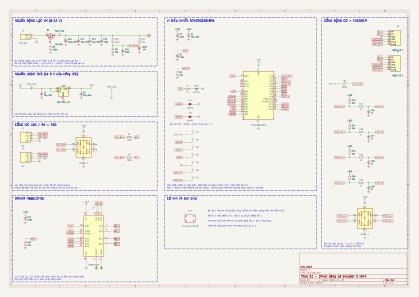

# S1 – Driver động cơ encoder 2 kênh: tài liệu thiết kế chi tiết

Phiên bản 0.1 – 16/11/2026. Viết theo sơ đồ [S1.kicad_sch](S1.kicad_sch) (56 linh kiện, ERC 0 lỗi). **Chưa có mạch in, chưa có firmware, chưa có bản mẫu.**

Tài liệu liên quan: [THIET-KE-MACH.md](../THIET-KE-MACH.md) mục 2 (khối lõi dùng chung S1, S2, S3) và mục 3; [THIET-KE-HE-THONG.md](../../docs/THIET-KE-HE-THONG.md) mục 4.2; [THIET-KE-CO-KHI.md](../../docs/THIET-KE-CO-KHI.md) mục 3.4.



## 1. Vai trò và thông số chính

S1 nhận lệnh qua I2C và tự điều khiển hai động cơ DC có encoder: bo chủ chỉ gửi «tốc độ», «đi 20 cm», «quay 90°», còn vòng PID chạy trên module.

| Hạng mục | Giá trị |
|---|---|
| Vi điều khiển | STM32G030K8T6 (LQFP-32, 64 KB flash, 8 KB RAM), dao động nội 16 MHz |
| Driver | TB6612FNG: 1,2 A liên tục, 3,2 A đỉnh mỗi kênh |
| Nguồn động lực | `VM` 6–12 V từ C2 qua XT30 (giới hạn của TB6612: 4,5–13,5 V), có chống ngược cực |
| Nguồn logic | 5 V của cổng I2C → 3,3 V; khoảng 40 mA |
| Giao tiếp | I2C tớ, 3,3 V, đến 400 kHz, địa chỉ 0x30–0x33 chọn bằng 2 cầu hàn; 2 cổng để nối chuỗi. Cắm vào cổng **I2C2** (bus tốc độ cao) của C1 |
| Encoder | 2 kênh vuông pha, đếm bằng timer phần cứng; cấp 3,3 V |
| Đo | điện áp `VM` (bước 8,9 mV) |
| Kích thước | 48 × 48 mm, 4 lỗ gá Ø3,2 tại (4, 4), (44, 4), (4, 44), (44, 44) |

## 2. Sơ đồ khối

```
 J3 XT30 đực ─► Q1 AO4435 (chống ngược) ─► VM ─┬─► C10 220 µF + C11, C12, C13 ─► U4 TB6612FNG ══► J4, J5
                                               ├─► R10/R11 (1/11) ─► PA0 (đo VM)
                                               └─► R21 + LED2 (báo có VM)

 J1, J2 cổng I2C ─┬─ +5V ─► U2 AP2112K ─► +3V3 ─► U1 STM32G030, VCC của U4, encoder
                  └─ SDA/SCL ─► U3 (ESD) ─► R1, R2 100 Ω ─► PB7/PB6

 U1 ─► PWMA/PWMB, AIN1/2, BIN1/2, STBY ─► U4
 J4, J5: EncA/EncB ─► U5 (ESD), kéo lên 10 k ─► 1 k + 1 nF ─► TIM1, TIM3 của U1
```

## 3. Cổng và thứ tự chân

| Ký hiệu | Cổng | Đầu cắm | Chân 1 → n |
|---|---|---|---|
| J1, J2 | I2C vào / ra | JST PH 4 chân | GND, 5V, SDA, SCL (hai cổng nối song song cả 4 chân) |
| J3 | Nguồn động lực | XT30 đực | 1 GND, 2 VBAT |
| J4 | Động cơ 1 | JST XH 6 chân | M+, M−, GND, 3V3, EncA, EncB |
| J5 | Động cơ 2 | JST XH 6 chân | M+, M−, GND, 3V3, EncA, EncB |
| TP1–TP5 | Nạp SWD | 5 điểm thử Ø1,5 | 3V3, SWDIO, SWCLK, NRST, GND |
| TP6, TP7 | Gỡ lỗi | 2 điểm thử | UART TX (PA2), RX (PA3) |

Thứ tự chân cổng động cơ khác với cáp sẵn của động cơ encoder bán trên thị trường: phải làm cáp riêng hoặc bo chuyển.

## 4. Gán chân STM32G030K8T6

| Chân | Tên | Chức năng | Lưới | Nối tới |
|---|---|---|---|---|
| 1 | PB9 | TIM17_CH1 | `PWMB` | U4 chân 15 |
| 4, 5 | VDD, VSS | nguồn | `+3V3`, GND | C3 100 nF, C4 10 µF |
| 6 | NRST | reset | `NRST` | C5 100 nF, TP4 |
| 7 | PA0 | ADC1_IN0 | `VM_SENSE` | R10/R11, C15 |
| 8 | PA1 | GPIO ra | `STBY` | U4 chân 19, R12 kéo xuống |
| 9, 10 | PA2, PA3 | USART2 TX, RX | `UART_TX`, `UART_RX` | TP6, TP7 |
| 11 | PA4 | GPIO ra | `AIN1` | U4 chân 21 |
| 12 | PA5 | GPIO ra | `AIN2` | U4 chân 22 |
| 13 | PA6 | GPIO ra | `BIN1` | U4 chân 17 |
| 14 | PA7 | GPIO ra | `BIN2` | U4 chân 16 |
| 15 | PB0 | GPIO ra | `LED` | R4 1 k + LED1 |
| 17 | PB2 | GPIO vào, kéo lên nội | `ADDR0` | JP1 xuống GND |
| 18 | PA8 | TIM1_CH1 | `ENC1_A` | encoder 1 kênh A |
| 24 | PA13 | SWDIO | `SWDIO` | TP2 |
| 25 | PA14 | SWCLK / BOOT0 | `SWCLK` | TP3, R3 10 k kéo xuống |
| 26 | PA15 | GPIO vào, kéo lên nội | `ADDR1` | JP2 xuống GND |
| 27 | PB3 | TIM1_CH2 | `ENC1_B` | encoder 1 kênh B |
| 28 | PB4 | TIM3_CH1 | `ENC2_A` | encoder 2 kênh A |
| 29 | PB5 | TIM3_CH2 | `ENC2_B` | encoder 2 kênh B |
| 30 | PB6 | I2C1_SCL | `SCL` | R2 |
| 31 | PB7 | I2C1_SDA | `SDA` | R1 |
| 32 | PB8 | TIM16_CH1 | `PWMA` | U4 chân 23 |
| 2, 3, 16, 19–23 | PC14, PC15, PB1, PA9, PC6, PA10, PA11, PA12 | không dùng | – | để hở |

Lý do chọn timer: trên G030 chỉ TIM1 và TIM3 có chế độ đếm encoder, nên hai timer này dành cho encoder; PWM lấy từ TIM16 và TIM17 (mỗi timer một kênh, đặt cùng tần số 20 kHz).

Nối TB6612FNG (U4):

| Chân U4 | Tên | Nối tới |
|---|---|---|
| 1, 2 | AO1 | `M1+` → J4 chân 1 |
| 5, 6 | AO2 | `M1-` → J4 chân 2 |
| 11, 12 | BO1 | `M2+` → J5 chân 1 |
| 7, 8 | BO2 | `M2-` → J5 chân 2 |
| 24, 13, 14 | VM1–VM3 | `VM` |
| 3, 4, 9, 10 | PGND | GND |
| 18 | GND | GND |
| 20 | VCC | `+3V3`, C14 100 nF |
| 23, 21, 22 | PWMA, AIN1, AIN2 | PB8, PA4, PA5 |
| 15, 17, 16 | PWMB, BIN1, BIN2 | PB9, PA6, PA7 |
| 19 | STBY | PA1 |

## 5. Mô tả từng khối

### 5.1. Nguồn động lực

| Linh kiện | Giá trị | Vai trò |
|---|---|---|
| Q1 | AO4435 (P-MOSFET, −30 V, −10 A, SOIC-8) | chống ngược cực: cực D về XT30, cực S về `VM` |
| R5 | 100 k | cực G của Q1 xuống GND |
| C10 | 220 µF 25 V, tụ hoá Ø8 | tụ khối, hấp thụ năng lượng khi động cơ hãm |
| C11, C12 | 10 µF 25 V | tụ gốm, mỗi cụm chân VM một tụ |
| C13 | 100 nF | tụ tách `VM` |
| R10, R11, C15 | 100 k, 10 k, 100 nF | phân áp 1/11 đo `VM`: 12 V → 1,09 V |
| R21 + LED2 | 10 k + LED | báo có `VM` (8,4 V → 0,6 mA) |

- Cắm đúng cực: diode thân của Q1 dẫn trước, rồi V_GS = −VM làm Q1 mở hẳn. Cắm ngược: Q1 khoá, mạch không có điện.
- Q1 có R_DS khoảng 20 mΩ ở V_GS = −7 V: 0,39 W ở 4,4 A (hai động cơ kẹt), 20 mW ở 1 A.
- Không đặt TVS trên `VM`: điện áp tuyệt đối của TB6612 là 15 V, còn TVS cho đường 12 V kẹp ở 17–20 V nên không bảo vệ được.
- Đo `VM`: ADC 12 bit, bước 3,3 / 4096 × 11 = 8,9 mV. Firmware dùng số này để báo «mất nguồn động lực» và bù PWM theo điện áp pin.

### 5.2. Nguồn logic

U2 AP2112K-3.3 (vào tối đa 6 V, 600 mA; EN nối VIN) lấy 5 V từ cổng I2C, với C1, C2 10 µF ở đầu vào và đầu ra.

Nguồn logic lấy từ cổng I2C chứ không lấy từ pin, vì hai lý do: vi điều khiển luôn sống khi bus sống nên không kéo sập SDA/SCL khi C2 tắt; và AP2112K không chịu được 8,4 V. Nhờ vậy S1 vẫn trả lời I2C và báo được «mất nguồn động lực».

Tải 3,3 V: vi điều khiển 5 mA, TB6612 khoảng 2 mA, hai encoder khoảng 20 mA, LED và kéo lên khoảng 5 mA; tổng khoảng 40 mA. U2 toả (5 − 3,3) × 0,04 = 68 mW.

### 5.3. Cổng I2C

- J1 và J2 nối song song. U3 (SRV05-4, VP = `+3V3`) bảo vệ `SDA_BUS`, `SCL_BUS`; R1, R2 (100 Ω) nằm giữa đầu cắm và vi điều khiển.
- Module **không có điện trở kéo lên** I2C; chỉ C1 có.
- Địa chỉ = 0x30 + (JP2, JP1), cầu hàn nối = 1: hở cả hai là 0x30, hàn JP1 là 0x31, hàn JP2 là 0x32, hàn cả hai là 0x33. Firmware đọc hai chân này một lần lúc khởi động (chân đọc mức thấp khi cầu đã hàn).

### 5.4. Vi điều khiển

| Linh kiện | Giá trị | Vai trò |
|---|---|---|
| C3, C4 | 100 nF, 10 µF | tụ tách, sát chân 4 và 5 |
| C5 | 100 nF | tụ chân NRST |
| R3 | 10 k | kéo PA14 (SWCLK kiêm BOOT0) xuống GND |
| R4 + LED1 | 1 k + LED | LED trạng thái trên PB0, mức cao = sáng |

Cảnh báo:

- **PA14 vừa là SWCLK vừa là BOOT0.** Nếu bit tuỳ chọn `nBOOT_SEL` = 0, mức cao trên chân này lúc reset đưa chip vào bootloader ROM. Giữ R3 và kiểm tra bit này khi nạp lần đầu.
- **Không dùng PA9–PA12**: chân 19, 21 của vỏ LQFP-32 dùng chung chức năng với chân 22, 23 qua cơ chế remap.
- Không được cấu hình NRST thành GPIO bằng option byte, nếu không sẽ mất đường nạp.
- Không dùng thạch anh: dao động nội HSI16 sai số ±1 %, đủ cho I2C tớ và PWM.

### 5.5. Driver

- R12 (10 k) kéo STBY xuống GND: động cơ tắt khi vi điều khiển đang reset hoặc chưa nạp firmware. Các chân vào khác của TB6612 có sẵn kéo xuống 200 kΩ bên trong.
- Bảng điều khiển một kênh: IN1 = 1, IN2 = 0 quay thuận; IN1 = 0, IN2 = 1 quay ngược; IN1 = IN2 = 1 hãm ngắn mạch; IN1 = IN2 = 0 thả trôi. Tốc độ đặt bằng PWM.
- Tổn hao: điện trở dẫn tổng hai nhánh khoảng 0,5 Ω. Ở 0,5 A mỗi kênh: 2 × 0,5² × 0,5 = 0,25 W. Ở 1 A mỗi kênh: 1 W, sát giới hạn của vỏ SSOP-24 (khoảng 0,8–1,3 W tuỳ diện tích đồng).
- Mạch không đo dòng động cơ. Bảo vệ quá tải dựa vào ngắt nhiệt của IC và phát hiện kẹt bằng encoder trong firmware.

### 5.6. Cổng động cơ và encoder

| Linh kiện | Giá trị | Vai trò |
|---|---|---|
| FB1 | ferrite 600 Ω, 0805 | `+3V3` → `+3V3_ENC` (chân 4 của J4, J5) |
| R13–R16 | 10 k lên `+3V3` | kéo lên 4 đường encoder (cần cho encoder có đầu ra cực thu hở) |
| R17–R20 + C16–C19 | 1 k + 1 nF | lọc thông thấp, tần số cắt 160 kHz |
| U5 | SRV05-4, VP = `+3V3` | chống tĩnh điện cho 4 đường encoder phía đầu cắm |

Encoder nhanh nhất khoảng 3,5 kHz (N20, 7 xung/vòng, 30 000 vòng/phút ở trục động cơ), thấp hơn tần số cắt 45 lần.

## 6. Danh sách linh kiện

| Ký hiệu | Số lượng | Giá trị | Vỏ | Mã LCSC |
|---|---|---|---|---|
| U1 | 1 | STM32G030K8T6 | LQFP-32 | C431631 |
| U2 | 1 | AP2112K-3.3TRG1 | SOT-23-5 | – |
| U3, U5 | 2 | SRV05-4 | SOT-23-6 | – |
| U4 | 1 | TB6612FNG | SSOP-24 | – |
| Q1 | 1 | AO4435 | SOIC-8 | – |
| FB1 | 1 | ferrite 600 Ω @100 MHz | 0805 | – |
| C10 | 1 | 220 µF 25 V, low-ESR | tụ hoá Ø8, bước 3,5 | – |
| C1, C2, C4, C11, C12 | 5 | 10 µF 25 V | 0805 | – |
| C3, C5, C13, C14, C15 | 5 | 100 nF | 0603 | – |
| C16–C19 | 4 | 1 nF | 0603 | – |
| R1, R2 | 2 | 100 Ω | 0603 | – |
| R3, R11, R12, R13–R16, R21 | 8 | 10 k | 0603 | – |
| R4, R17–R20 | 5 | 1 k | 0603 | – |
| R5, R10 | 2 | 100 k | 0603 | – |
| LED1, LED2 | 2 | LED | 0603 | – |
| JP1, JP2 | 2 | cầu hàn 2 chân, mặc định hở | – | – |
| J1, J2 | 2 | JST PH 4 chân nằm ngang | xuyên lỗ | – |
| J3 | 1 | XT30 đực | xuyên lỗ | – |
| J4, J5 | 2 | JST XH 6 chân nằm ngang | xuyên lỗ | – |
| TP1–TP7 | 7 | điểm thử Ø1,5 | – | – |

## 7. Cơ khí và bố trí linh kiện

Gốc toạ độ ở góc dưới trái của bo (mm).

| Thành phần | Vị trí |
|---|---|
| 2 cổng I2C (J1, J2) | cạnh trái, y = 17 và y = 31 |
| 2 cổng động cơ (J4, J5) | giữa cạnh trên và giữa cạnh dưới, mỗi cổng quay về một động cơ |
| XT30 (J3) | cạnh phải, tâm (44, 24) |
| TB6612FNG (U4) | (26, 30) |
| STM32G030 (U1) | (26, 17) |

## 8. Hướng dẫn đi mạch in

- Đường `VM`, GND động lực và 4 đường ra động cơ rộng tối thiểu 1,5 mm; đổ đồng rộng cho chân PGND và các chân ra của U4 để tản nhiệt.
- C10, C11, C12, C13 sát chân VM của U4. Dòng động cơ về XT30 không được chảy qua vùng GND dưới vi điều khiển: tách hai vùng, nối nhau tại một điểm gần J3.
- 5 điểm nạp TP1–TP5 xếp thành hàng, bước 2,54 mm, theo thứ tự 3V3, SWDIO, SWCLK, NRST, GND để dùng chung một đồ gá nạp với S2, S3.
- Mạch lọc encoder (R17–R20, C16–C19) sát vi điều khiển; U5 sát đầu cắm.
- Hai lớp, mặt dưới đổ đồng GND, linh kiện dán một mặt.

## 9. Yêu cầu firmware

Thư mục `firmware/S1-driver-dong-co/` còn trống. Yêu cầu lấy từ tài liệu hệ thống:

- Khung I2C chung với S2, S3: thanh ghi 0x00 = mã loại module, 0x01 = phiên bản firmware. Các thanh ghi còn lại **chưa định nghĩa**.
- Cập nhật firmware qua I2C bằng bootloader riêng, để giáo viên không cần mạch nạp.
- Vòng PID vận tốc 1 kHz; vòng vị trí có giới hạn gia tốc.
- Chế độ: dừng, PWM thô, vận tốc, vị trí. Tự dừng sau 500 ms không nhận lệnh.
- Số xung encoder và tỉ số truyền lưu trong flash, để cùng một module chạy được N20 lẫn JGA25-370.
- Cắt PWM khi encoder đứng yên quá 0,5 s ở PWM cao (kẹt trục): JGA25-370 có thể kéo 2,2 A, vượt 1,2 A liên tục của driver.
- Báo điện áp `VM` và cờ mất nguồn động lực.
- Giữ STBY thấp cho tới khi cấu hình xong PWM.

Khối lệnh MicroBlocks dự kiến: `đặt tốc độ trái ◯ phải ◯`, `đi thẳng ◯ cm`, `quay ◯ độ`, `đã tới đích?`, `quãng đường`.

## 10. Kiểm thử bản mẫu

1. Đo không chập `+5V`, `+3V3`, `VM` với GND.
2. Cấp 5 V qua cổng I2C (chưa cấp `VM`): `+3V3` = 3,3 V; ghi lại dòng tiêu thụ.
3. Nạp qua SWD; kiểm bit `nBOOT_SEL`; LED1 nháy.
4. Quét I2C từ C1: thấy 0x30. Hàn JP1, JP2 lần lượt: địa chỉ đổi đúng bảng.
5. Cấp `VM` 7,4 V giới hạn 0,5 A: LED2 sáng; đọc điện áp `VM` qua ADC, sai dưới 2 %.
6. Đảo cực nguồn `VM`: không có dòng, không hỏng.
7. Chạy từng động cơ ở PWM thô, hai chiều; kiểm chiều quay khớp chiều đếm encoder.
8. Xem dạng sóng encoder sau bộ lọc ở tốc độ cao nhất: còn vuông, không mất xung.
9. Giữ kẹt trục: firmware cắt PWM trong 0,5 s; đo nhiệt U4.
10. Chạy hai động cơ JGA25-370 có tải 10 phút: nhiệt U4 và Q1.
11. Rút cáp I2C khi động cơ đang chạy: động cơ dừng sau 500 ms.
12. Tắt C2 khi C1 còn điện: bus I2C vẫn chạy, S1 báo mất nguồn động lực.

## 11. Vấn đề mở

| Việc | Ghi chú |
|---|---|
| Bản đồ thanh ghi I2C | Mới có 0x00 và 0x01; phải định nghĩa trước khi viết firmware và thư viện khối |
| Tốc độ vòng điều khiển xe cân bằng | Cần đọc S3 → PID → gửi lệnh S1 ở khoảng 100 Hz trở lên qua I2C; chưa đo |
| Đầu cắm động cơ | Sơ đồ dùng JST XH 6 chân; mô hình cơ khí đang vẽ khối đầu 6 chân cỡ PH (13,9 mm). XH 6 chân rộng hơn (khoảng 17,4 mm), cần cập nhật mô hình |
| Nhiệt của TB6612 với JGA25-370 | 1 A mỗi kênh là sát giới hạn vỏ; đo trên bản mẫu |
| Cáp động cơ | Thứ tự chân khác cáp bán sẵn |
| Mã LCSC | Mới có mã của U1 |
