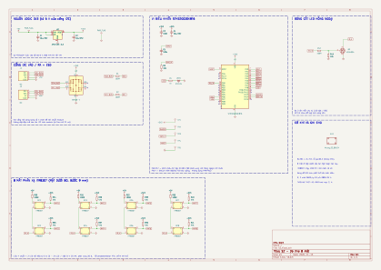

# S2 – Dò line 8 mắt: tài liệu thiết kế chi tiết

Phiên bản 0.1 – 16/11/2026. Viết theo sơ đồ [S2.kicad_sch](S2.kicad_sch) (44 linh kiện, ERC 0 lỗi). **Chưa có mạch in, chưa có firmware, chưa có bản mẫu.** Khoảng cách đọc của mắt chưa được thử (mục 11).

Tài liệu liên quan: [THIET-KE-MACH.md](../THIET-KE-MACH.md) mục 2 (khối lõi dùng chung S1, S2, S3) và mục 4; [THIET-KE-HE-THONG.md](../../docs/THIET-KE-HE-THONG.md) mục 4.2; [THIET-KE-CO-KHI.md](../../docs/THIET-KE-CO-KHI.md) mục 3.5.



## 1. Vai trò và thông số chính

S2 đọc 8 mắt phản xạ hồng ngoại, tự hiệu chuẩn đen/trắng và trả cho bo chủ một con số «vị trí line» đã tính sẵn.

| Hạng mục | Giá trị |
|---|---|
| Vi điều khiển | STM32G030K8T6 (LQFP-32), dao động nội 16 MHz |
| Cảm biến | 8 × ITR8307 (LED hồng ngoại + phototransistor), **mặt dưới bo**, bước 9 mm, bề ngang đọc 63 mm |
| Nguồn | 5 V của cổng I2C; 3,3 V tại chỗ cho vi điều khiển và tải phototransistor |
| Dòng tiêu thụ | khoảng 10 mA khi LED tắt; 100 mA trong lúc phát xung; trung bình khoảng 30 mA ở xung 20 % |
| Giao tiếp | I2C tớ, 3,3 V, đến 400 kHz, địa chỉ cố định 0x34; 2 cổng để nối chuỗi. Thường nối chuỗi sau S1 trên bus **I2C2** của C1 |
| Kích thước | 80 × 24 mm, 4 lỗ gá Ø3,2 tại (4, 4), (76, 4), (4, 20), (76, 20) |
| Lắp | treo dưới mũi xe bằng 4 trụ M3 × 12, mặt mắt cách sàn 5,9 mm |

## 2. Sơ đồ khối

```
 +5V ─► R30–R33 (100 Ω) ─► 4 chuỗi × 2 LED hồng ngoại nối tiếp ─► IR_K ─► Q2 AO3400A ◄─ PB0 (IR_EN)
 +3V3 ─► R34–R41 (47 k) ─► cực C của 8 phototransistor ─► PA0…PA7 (ADC)

 J1, J2 cổng I2C ─┬─ +5V ─► U2 AP2112K ─► +3V3 ─► U1 STM32G030
                  └─ SDA/SCL ─► U3 (ESD) ─► R1, R2 100 Ω ─► PB7/PB6
```

## 3. Cổng và thứ tự chân

| Ký hiệu | Cổng | Đầu cắm | Chân 1 → n |
|---|---|---|---|
| J1, J2 | I2C vào / ra | JST PH 4 chân | GND, 5V, SDA, SCL (hai cổng nối song song cả 4 chân) |
| TP1–TP5 | Nạp SWD | 5 điểm thử Ø1,5 | 3V3, SWDIO, SWCLK, NRST, GND |

S2 không có điểm thử UART: PA2, PA3 đã dùng cho mắt 3 và mắt 4.

## 4. Gán chân STM32G030K8T6

| Chân | Tên | Chức năng | Lưới | Nối tới |
|---|---|---|---|---|
| 4, 5 | VDD, VSS | nguồn | `+3V3`, GND | C3 100 nF, C4 10 µF |
| 6 | NRST | reset | `NRST` | C5 100 nF, TP4 |
| 7 | PA0 | ADC1_IN0 | `MAT1` | OP1, R34 |
| 8 | PA1 | ADC1_IN1 | `MAT2` | OP2, R35 |
| 9 | PA2 | ADC1_IN2 | `MAT3` | OP3, R36 |
| 10 | PA3 | ADC1_IN3 | `MAT4` | OP4, R37 |
| 11 | PA4 | ADC1_IN4 | `MAT5` | OP5, R38 |
| 12 | PA5 | ADC1_IN5 | `MAT6` | OP6, R39 |
| 13 | PA6 | ADC1_IN6 | `MAT7` | OP7, R40 |
| 14 | PA7 | ADC1_IN7 | `MAT8` | OP8, R41 |
| 15 | PB0 | GPIO ra | `IR_EN` | R42 → cực G của Q2 |
| 18 | PA8 | GPIO ra | `LED` | R4 1 k + LED1 |
| 24 | PA13 | SWDIO | `SWDIO` | TP2 |
| 25 | PA14 | SWCLK / BOOT0 | `SWCLK` | TP3, R3 10 k kéo xuống |
| 30 | PB6 | I2C1_SCL | `SCL` | R2 |
| 31 | PB7 | I2C1_SDA | `SDA` | R1 |
| còn lại | – | không dùng | – | để hở |

Mắt 1 đến mắt 8 xếp theo thứ tự OP1 → OP8 dọc cạnh dài của bo. Chiều trái–phải so với xe phụ thuộc cách lắp; firmware phải có tham số đảo chiều.

## 5. Mô tả từng khối

### 5.1. Nguồn, cổng I2C, vi điều khiển

Giống khối lõi của S1 và S3:

| Linh kiện | Giá trị | Vai trò |
|---|---|---|
| U2 + C1, C2 | AP2112K-3.3 + 10 µF × 2 | 5 V của cổng I2C → `+3V3`; EN nối VIN |
| U3 | SRV05-4, VP = `+3V3` | chống tĩnh điện cho `SDA_BUS`, `SCL_BUS` |
| R1, R2 | 100 Ω | nối tiếp SDA, SCL giữa đầu cắm và vi điều khiển |
| C3, C4, C5 | 100 nF, 10 µF, 100 nF | tụ tách VDD; tụ NRST |
| R3 | 10 k | kéo PA14 (SWCLK kiêm BOOT0) xuống GND |
| R4 + LED1 | 1 k + LED | LED trạng thái trên PA8 |

Các cảnh báo về PA14-BOOT0, PA9–PA12 và NRST giống S1 (xem [THIET-KE-S1.md](../S1-driver-dong-co/THIET-KE-S1.md) mục 5.4). Module không có điện trở kéo lên I2C. Địa chỉ 0x34 đặt trong firmware, không có cầu hàn.

### 5.2. LED hồng ngoại

| Linh kiện | Giá trị | Vai trò |
|---|---|---|
| OP1–OP8 | ITR8307 | chân 1 K, 2 A (LED); 3 C, 4 E (phototransistor) |
| R30–R33 | 100 Ω | hạn dòng, mỗi chuỗi một điện trở từ `+5V` |
| Q2 | AO3400A | đóng cắt cả 4 chuỗi: cực D = `IR_K`, cực S = GND |
| R42, R43 | 100 Ω cực G, 10 k kéo xuống | LED tắt khi vi điều khiển đang reset |

Bốn chuỗi, mỗi chuỗi hai LED nối tiếp: OP1 + OP2 (R30), OP3 + OP4 (R31), OP5 + OP6 (R32), OP7 + OP8 (R33).

- Dòng mỗi chuỗi: (5 − 2 × 1,2 − 0,05) / 100 = 25 mA; 100 mA cho 4 chuỗi khi bật. Phát xung 20 % nên trung bình 20 mA.
- Nối hai LED nối tiếp từ 5 V giảm một nửa dòng so với cấp riêng từng LED.
- LED lấy điện từ `+5V` của cổng, không qua ổn áp 3,3 V, nên xung 100 mA không làm nhiễu nguồn của vi điều khiển. Điện áp `+5V` thay đổi (USB hay C2) làm dòng LED đổi theo khoảng 4 % cho mỗi 0,1 V; phép hiệu chuẩn đen/trắng bù được.

### 5.3. Phototransistor và đo ADC

Mỗi phototransistor có cực E nối GND, cực C nối điện trở tải 47 k (R34–R41) lên `+3V3` và về một kênh ADC.

- Nền **trắng** phản xạ nhiều → phototransistor dẫn → điện áp **thấp**. Vạch **đen** → điện áp **cao** (gần 3,3 V).
- Mỗi chu kỳ đo hai lần, LED tắt rồi LED bật, lấy hiệu để loại ánh sáng nền.
- Với tải 47 k, phototransistor đáp ứng chậm (cỡ vài trăm micro giây): sau khi bật LED phải chờ điện áp ổn định rồi mới lấy mẫu. Thời gian chờ đo trên bản mẫu.
- Trở kháng nguồn 47 k là cao đối với ADC của G030: đặt thời gian lấy mẫu dài (79,5 hoặc 160,5 chu kỳ ADC) và đối chiếu bảng trở kháng nguồn tối đa trong datasheet.
- 47 k là giá trị khởi đầu, chỉnh khi thử: tăng để nhạy hơn ở khoảng cách xa, giảm để nhanh hơn và ít bão hoà.
- Dòng 3,3 V của khối tải: 8 × 3,3 V / 47 k = 0,6 mA.

## 6. Danh sách linh kiện

| Ký hiệu | Số lượng | Giá trị | Vỏ | Mã LCSC |
|---|---|---|---|---|
| U1 | 1 | STM32G030K8T6 | LQFP-32 | C431631 |
| U2 | 1 | AP2112K-3.3TRG1 | SOT-23-5 | – |
| U3 | 1 | SRV05-4 | SOT-23-6 | – |
| OP1–OP8 | 8 | ITR8307/S17/TR8(B) | SMD 3,4 × 2,7 × 1,5, **mặt dưới** | – |
| Q2 | 1 | AO3400A | SOT-23 | – |
| C1, C2, C4 | 3 | 10 µF 25 V | 0805 | – |
| C3, C5 | 2 | 100 nF | 0603 | – |
| R1, R2, R30–R33, R42 | 7 | 100 Ω | 0603 | – |
| R3, R43 | 2 | 10 k | 0603 | – |
| R4 | 1 | 1 k | 0603 | – |
| R34–R41 | 8 | 47 k | 0603 | – |
| LED1 | 1 | LED | 0603 | – |
| J1, J2 | 2 | JST PH 4 chân nằm ngang | xuyên lỗ | – |
| TP1–TP5 | 5 | điểm thử Ø1,5 | – | – |

## 7. Cơ khí và bố trí linh kiện

Gốc toạ độ ở góc dưới trái của bo, nhìn từ mặt trên (mm).

| Thành phần | Vị trí |
|---|---|
| 8 mắt đọc, **mặt dưới** | hàng y = 5, x = 8,5 + 9 × n (n = 0…7) |
| 2 cổng I2C (J1, J2), mặt trên | cạnh trên, x = 28 và x = 52 |
| STM32G030 (U1), mặt trên | (40, 8) |

Hàng mắt đọc cách trục bánh xe 131 mm trên xe dò line (K2).

## 8. Hướng dẫn đi mạch in

- 8 mắt ở mặt dưới, mọi linh kiện khác ở mặt trên. Đặt lắp máy hai mặt ở xưởng, hoặc lắp máy mặt trên và hàn tay 8 mắt.
- Chân của đầu cắm JST xuyên lỗ nhô xuống mặt dưới 1,5–2 mm, ngang hoặc cao hơn thân mắt (1,5 mm): giữ chúng xa hàng mắt và cắt ngắn sau khi hàn.
- Dưới mỗi mắt không đặt via hay điểm hàn hở; phủ sơn hàn đen quanh hàng mắt nếu xưởng cho chọn màu, để giảm phản xạ lạc.
- Đường từ cực C của mắt về ADC là đường trở kháng cao (47 k): đi ngắn, xa đường `IR_K` và đường I2C, có đồng GND kèm bên.
- Đường `+5V` → điện trở → LED → `IR_K` → Q2 mang xung 100 mA: đi rộng 0,5 mm, về GND gần đầu cắm chứ không chạy qua vùng GND của mạch ADC.
- R34–R41 đặt gần vi điều khiển; R30–R33 gần các mắt.
- 5 điểm nạp theo đúng hàng và thứ tự của S1, S3.

## 9. Yêu cầu firmware

Thư mục `firmware/S2-do-line/` còn trống. Yêu cầu lấy từ tài liệu hệ thống:

- Khung I2C chung: thanh ghi 0x00 = mã loại module, 0x01 = phiên bản firmware. Các thanh ghi còn lại **chưa định nghĩa**.
- Cập nhật firmware qua I2C bằng bootloader chung.
- Tự hiệu chuẩn đen/trắng cho từng mắt, lưu vào flash.
- Trả về: vị trí line (−100…100), mặt nạ 8 bit, cờ ngã tư, cờ mất line, giá trị thô từng mắt.
- Chu kỳ đo: tắt LED → đo 8 kênh → bật LED → chờ ổn định → đo 8 kênh → tắt LED; LED bật không quá 20 % thời gian.

Khối lệnh MicroBlocks dự kiến: `hiệu chuẩn`, `vị trí line`, `gặp ngã tư?`, `mất line?`.

## 10. Kiểm thử bản mẫu

1. Đo không chập `+5V`, `+3V3` với GND.
2. Cấp 5 V qua cổng I2C: `+3V3` = 3,3 V. Nạp qua SWD; kiểm bit `nBOOT_SEL`.
3. Quét I2C từ C1: thấy 0x34.
4. Bật LED liên tục: đo dòng mỗi chuỗi (khoảng 25 mA) bằng sụt áp trên R30–R33; nhìn LED qua camera điện thoại để chắc cả 8 đều sáng.
5. **Thử khoảng cách đọc**: đặt bo trên giấy trắng và băng đen ở các khoảng cách 2, 4, 6, 8 mm; ghi điện áp từng mắt khi LED bật và tắt. Cần chênh lệch trắng–đen tối thiểu khoảng 1 V ở 5,9 mm.
6. Đo thời gian điện áp ổn định sau khi bật LED bằng máy hiện sóng; chốt thời gian chờ trong firmware.
7. Thử dưới ánh sáng mạnh (đèn bàn, nắng qua cửa sổ): hiệu hai lần đo vẫn tách được đen–trắng.
8. Kiểm độ đồng đều giữa 8 mắt trước và sau hiệu chuẩn.
9. Chạy thử trên xe với vạch 15–20 mm, có ngã tư.

## 11. Vấn đề mở

| Việc | Ghi chú |
|---|---|
| **Khoảng cách đọc** | ITR8307 nhạy nhất ở khoảng 1 mm, trong khi thiết kế cơ khí để mặt mắt cách sàn 5,9 mm. Chưa tra được đường cong chính xác. Nếu tín hiệu yếu: rút trụ treo xuống 8–9 mm, hoặc đổi sang mắt có tầm xa hơn |
| Số chân của ký hiệu `IRIS:Mat_ITR8307` | Đối chiếu với datasheet Everlight trước khi đi mạch in |
| Giá trị R34–R41 | 47 k là khởi đầu; chốt sau bước thử 5 và 6 |
| Lắp hai mặt | Chọn giữa lắp máy hai mặt và hàn tay 8 mắt |
| Bản đồ thanh ghi I2C | Mới có 0x00 và 0x01 |
| Bản động cơ JGA25-370 | Tâm trục cao hơn 9 mm, trụ treo S2 phải dài thêm tương ứng |
| Mã LCSC | Mới có mã của U1 |
