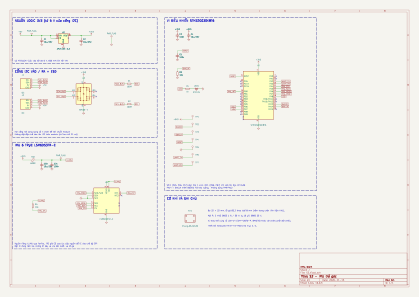

# S3 – IMU trả góc: tài liệu thiết kế chi tiết

Phiên bản 0.1 – 16/11/2026. Viết theo sơ đồ [S3.kicad_sch](S3.kicad_sch) (28 linh kiện, ERC 0 lỗi). **Chưa có mạch in, chưa có firmware, chưa có bản mẫu.**

Tài liệu liên quan: [THIET-KE-MACH.md](../THIET-KE-MACH.md) mục 2 (khối lõi dùng chung S1, S2, S3) và mục 5; [THIET-KE-HE-THONG.md](../../docs/THIET-KE-HE-THONG.md) mục 4.2; [THIET-KE-CO-KHI.md](../../docs/THIET-KE-CO-KHI.md) mục 3.6.



## 1. Vai trò và thông số chính

S3 đọc cảm biến quán tính 6 trục, chạy bộ lọc ngay trên module và trả cho bo chủ các góc đã tính sẵn, để học sinh không phải xử lý số liệu thô.

| Hạng mục | Giá trị |
|---|---|
| Vi điều khiển | STM32G030K8T6 (LQFP-32), dao động nội 16 MHz |
| Cảm biến | LSM6DS3TR-C (gia tốc 3 trục + con quay 3 trục, LGA-14 2,5 × 3 mm) |
| Nối cảm biến | SPI1, kèm ngắt dữ liệu sẵn sàng INT1 |
| Nguồn | 5 V của cổng I2C → 3,3 V; khoảng 10 mA |
| Giao tiếp | I2C tớ, 3,3 V, địa chỉ cố định 0x36; 2 cổng để nối chuỗi |
| Kích thước | 32 × 32 mm, 4 lỗ gá Ø3,2 tại (4, 4), (28, 4), (4, 28), (28, 28) |

## 2. Sơ đồ khối

```
 J1, J2 cổng I2C ─┬─ +5V ─► U2 AP2112K ─► +3V3 ─┬─► U1 STM32G030
                  │                             └─► FB2 ─► V_IMU ─► U5 LSM6DS3TR-C
                  └─ SDA/SCL ─► U3 (ESD) ─► R1, R2 100 Ω ─► PB7/PB6

 U1 ◄═ SPI1 (PA5 SCK, PA6 MISO, PA7 MOSI, PA4 CS) ═► U5;  U5 INT1 ─► PB0
```

## 3. Cổng và thứ tự chân

| Ký hiệu | Cổng | Đầu cắm | Chân 1 → n |
|---|---|---|---|
| J1, J2 | I2C vào / ra | JST PH 4 chân | GND, 5V, SDA, SCL (hai cổng nối song song cả 4 chân) |
| TP1–TP5 | Nạp SWD | 5 điểm thử Ø1,5 | 3V3, SWDIO, SWCLK, NRST, GND |
| TP6, TP7 | Gỡ lỗi | 2 điểm thử | UART TX (PA2), RX (PA3) |

## 4. Gán chân

STM32G030K8T6 (U1):

| Chân | Tên | Chức năng | Lưới | Nối tới |
|---|---|---|---|---|
| 4, 5 | VDD, VSS | nguồn | `+3V3`, GND | C3 100 nF, C4 10 µF |
| 6 | NRST | reset | `NRST` | C5 100 nF, TP4 |
| 9, 10 | PA2, PA3 | USART2 TX, RX | `UART_TX`, `UART_RX` | TP6, TP7 |
| 11 | PA4 | GPIO ra | `IMU_CS` | U5 chân 12, R5 kéo lên |
| 12 | PA5 | SPI1_SCK | `IMU_SCK` | U5 chân 13 |
| 13 | PA6 | SPI1_MISO | `IMU_MISO` | U5 chân 1 |
| 14 | PA7 | SPI1_MOSI | `IMU_MOSI` | U5 chân 14 |
| 15 | PB0 | GPIO vào, ngắt ngoài | `IMU_INT` | U5 chân 4 |
| 18 | PA8 | GPIO ra | `LED` | R4 1 k + LED1 |
| 24 | PA13 | SWDIO | `SWDIO` | TP2 |
| 25 | PA14 | SWCLK / BOOT0 | `SWCLK` | TP3, R3 10 k kéo xuống |
| 30 | PB6 | I2C1_SCL | `SCL` | R2 |
| 31 | PB7 | I2C1_SDA | `SDA` | R1 |
| còn lại | – | không dùng | – | để hở |

LSM6DS3TR-C (U5):

| Chân | Tên | Nối tới |
|---|---|---|
| 1 | SDO/SA0 | `IMU_MISO` (PA6) |
| 2, 3 | SDX, SCX | GND |
| 4 | INT1 | `IMU_INT` (PB0) |
| 5 | VDDIO | `V_IMU` |
| 6, 7 | GND | GND |
| 8 | VDD | `V_IMU` |
| 9 | INT2 | để hở |
| 10, 11 | NC | để hở |
| 12 | CS | `IMU_CS` (PA4), R5 10 k kéo lên `V_IMU` |
| 13 | SCL | `IMU_SCK` (PA5) |
| 14 | SDA | `IMU_MOSI` (PA7) |

## 5. Mô tả từng khối

### 5.1. Nguồn, cổng I2C, vi điều khiển

Giống khối lõi của S1 và S2:

| Linh kiện | Giá trị | Vai trò |
|---|---|---|
| U2 + C1, C2 | AP2112K-3.3 + 10 µF × 2 | 5 V của cổng I2C → `+3V3`; EN nối VIN |
| U3 | SRV05-4, VP = `+3V3` | chống tĩnh điện cho `SDA_BUS`, `SCL_BUS` |
| R1, R2 | 100 Ω | nối tiếp SDA, SCL giữa đầu cắm và vi điều khiển |
| C3, C4, C5 | 100 nF, 10 µF, 100 nF | tụ tách VDD; tụ NRST |
| R3 | 10 k | kéo PA14 (SWCLK kiêm BOOT0) xuống GND |
| R4 + LED1 | 1 k + LED | LED trạng thái trên PA8 |

Các cảnh báo về PA14-BOOT0, PA9–PA12 và NRST giống S1 (xem [THIET-KE-S1.md](../S1-driver-dong-co/THIET-KE-S1.md) mục 5.4). Module không có điện trở kéo lên I2C. Địa chỉ 0x36 đặt trong firmware, không có cầu hàn.

### 5.2. Cảm biến

| Linh kiện | Giá trị | Vai trò |
|---|---|---|
| U5 | LSM6DS3TR-C (LCSC C967633, loại Extended) | gia tốc ±2…±16 g, con quay ±125…±2000 °/s |
| FB2 | ferrite 600 Ω, 0805 | `+3V3` → `V_IMU`: chặn nhiễu số vào nguồn cảm biến |
| C20, C21 | 10 µF, 100 nF | tụ trên `V_IMU`, sát chân 8 và chân 5 |
| R5 | 10 k | kéo CS lên `V_IMU` |

- **Dùng SPI** thay vì một bus I2C thứ hai: đọc 1 kHz ổn định, và bộ I2C của vi điều khiển chỉ phải làm tớ.
- **R5 bắt buộc**: giữ CS ở mức cao (SPI nghỉ) khi vi điều khiển đang reset, để chân này không nổi. Khi CS cao, IC vẫn nghe I2C trên chân 13 và 14; firmware nên tắt giao tiếp I2C của IC (bit `I2C_disable` trong thanh ghi CTRL4_C) ngay sau khi khởi động.
- SPI chế độ 3 (xung nghỉ ở mức cao, lấy mẫu ở sườn lên), tối đa 10 MHz; dùng 4–8 MHz là đủ.
- INT1 báo có mẫu mới: firmware đọc theo ngắt thay vì hỏi vòng, nên mẫu đều nhau.
- Tốc độ lấy mẫu của IC là các bậc cố định (…416, 833, 1660 Hz…). Để có vòng lọc khoảng 1 kHz, đặt 833 Hz hoặc 1660 Hz.
- Dòng: cảm biến dưới 1 mA ở chế độ hiệu năng cao; vi điều khiển khoảng 5 mA; LED 2 mA.

## 6. Danh sách linh kiện

| Ký hiệu | Số lượng | Giá trị | Vỏ | Mã LCSC |
|---|---|---|---|---|
| U1 | 1 | STM32G030K8T6 | LQFP-32 | C431631 |
| U2 | 1 | AP2112K-3.3TRG1 | SOT-23-5 | – |
| U3 | 1 | SRV05-4 | SOT-23-6 | – |
| U5 | 1 | LSM6DS3TR-C | LGA-14 2,5 × 3 | C967633 |
| FB2 | 1 | ferrite 600 Ω @100 MHz | 0805 | – |
| C1, C2, C4, C20 | 4 | 10 µF 25 V | 0805 | – |
| C3, C5, C21 | 3 | 100 nF | 0603 | – |
| R1, R2 | 2 | 100 Ω | 0603 | – |
| R3, R5 | 2 | 10 k | 0603 | – |
| R4 | 1 | 1 k | 0603 | – |
| LED1 | 1 | LED | 0603 | – |
| J1, J2 | 2 | JST PH 4 chân nằm ngang | xuyên lỗ | – |
| TP1–TP7 | 7 | điểm thử Ø1,5 | – | – |

## 7. Cơ khí và bố trí linh kiện

Gốc toạ độ ở góc dưới trái của bo (mm).

| Thành phần | Vị trí |
|---|---|
| Cảm biến (U5) | đúng tâm bo (16, 16), cạnh IC song song cạnh bo |
| 2 cổng I2C (J1, J2) | giữa cạnh dưới và giữa cạnh trên |
| Vi điều khiển (U1) | lệch trái, quanh (8, 16) |

Trục đo phải trùng trục xe: in mũi tên X, Y lên lớp in lụa theo hình trục trong datasheet của IC. Trên xe cân bằng, S3 gắn trên tấm trên tại (8, 0).

Mô hình cơ khí vẽ vi điều khiển là khối 5 × 5 mm, còn sơ đồ dùng vỏ LQFP-32 (thân 7 × 7, cả chân 9 × 9). Phần giữa hai đầu cắm chỉ rộng khoảng 32 × 17 mm; phải kiểm chỗ khi đi mạch in (mục 11).

## 8. Hướng dẫn đi mạch in

- **Dưới U5**: không đi dây, không đặt via ở lớp trên; lớp dưới là đồng GND liền.
- **Ứng suất cơ**: U5 xa lỗ gá và xa đầu cắm (siết vít hay cắm rút dây làm bo cong, lệch điểm không của cảm biến). Không đặt linh kiện cao sát U5.
- **Nhiệt**: U2 đặt xa U5; nhiệt làm trôi điểm không của con quay.
- C21 (100 nF) sát chân 5 và 8 của U5; FB2 và C20 ngay cạnh.
- Dây SPI ngắn, không chạy song song sát đường I2C.
- LGA-14 không có chân lộ ra ngoài: cần lắp máy; hàn tay rất khó. Kiểm tra bằng cách đọc thanh ghi WHO_AM_I.
- 5 điểm nạp theo đúng hàng và thứ tự của S1, S2.

## 9. Yêu cầu firmware

Thư mục `firmware/S3-imu/` còn trống. Yêu cầu lấy từ tài liệu hệ thống:

- Khung I2C chung: thanh ghi 0x00 = mã loại module, 0x01 = phiên bản firmware. Các thanh ghi còn lại **chưa định nghĩa**.
- Cập nhật firmware qua I2C bằng bootloader chung.
- Bộ lọc ghép gia tốc và con quay chạy khoảng 1 kHz.
- Trả về: góc nghiêng trước–sau, trái–phải, góc xoay, vận tốc góc, cờ rung/va chạm.
- Hiệu chuẩn điểm không của con quay khi đứng yên lúc khởi động; lưu độ lệch vào flash.
- Góc xoay (quanh trục đứng) chỉ tính bằng tích phân con quay nên trôi dần theo thời gian; tài liệu cho học sinh phải nói rõ điều này. Bo không có la bàn.
- Bo chủ đọc góc không được làm gián đoạn vòng lọc: chụp sẵn bộ số liệu mới nhất để trả lời I2C trong ngắt.

## 10. Kiểm thử bản mẫu

1. Đo không chập `+5V`, `+3V3` với GND.
2. Cấp 5 V qua cổng I2C: `+3V3` và `V_IMU` = 3,3 V. Nạp qua SWD; kiểm bit `nBOOT_SEL`.
3. Đọc WHO_AM_I của U5 qua SPI: phải trả 0x6A.
4. Để yên trên bàn phẳng: gia tốc trục Z ≈ 1 g, hai trục kia ≈ 0; con quay gần 0 sau hiệu chuẩn.
5. Nghiêng 90° theo từng trục: dấu và trục khớp mũi tên in trên bo.
6. Kiểm ngắt INT1 đều đúng tần số đã đặt bằng máy hiện sóng.
7. Quét I2C từ C1: thấy 0x36. Đọc góc liên tục ở 100 Hz trong khi vòng lọc chạy: không mất mẫu.
8. Đo độ trôi góc xoay trong 5 phút đứng yên.
9. Siết 4 vít gá rồi đo lại điểm không: so với lúc chưa siết.
10. Gắn lên xe cân bằng, chạy động cơ: xem nhiễu rung trên góc nghiêng.

## 11. Vấn đề mở

| Việc | Ghi chú |
|---|---|
| Chỗ cho vi điều khiển | LQFP-32 (9 × 9 mm cả chân) trên bo 32 × 32 có 2 đầu cắm và 4 lỗ gá là rất chật. Nếu không vừa: đặt linh kiện hai mặt, hoặc đổi sang vi điều khiển cùng họ có vỏ QFN-32 5 × 5 (ví dụ STM32G031K8U6; phải kiểm tương thích chân, giá và thêm chân linh kiện) |
| Tốc độ vòng xe cân bằng | Đọc S3 → PID → gửi S1 qua I2C cần khoảng 100 Hz trở lên; chưa đo |
| Bản đồ thanh ghi I2C | Mới có 0x00 và 0x01 |
| IC thay thế | ICM-42670-P, BMI270 cùng vỏ LGA-14 nhưng khác vài chân; phải đối chiếu nếu đổi |
| Mã LCSC | Có mã U1 và U5; còn lại chưa tra |
